<div align="center">

# Modex · Foundations

**Sistema de diseño «HUD» de _Apuntes 1.º DAW_**

`Versión 1.0` · `Estado: estable` · `Fuente de verdad: css/tokens.css` · `Licencia de la tipografía: SIL OFL 1.1`

</div>

<p align="center">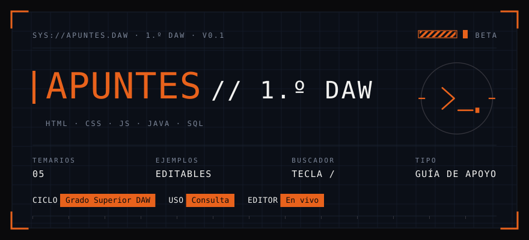</p>


> **Foundations** es el documento normativo del sistema de diseño de Modex. Define _qué_ se usa y _por qué_ (principios, color, tipografía,
> espaciado, forma, movimiento), _cómo_ se compone (componentes con su anatomía, estados y tokens) y _quién decide_ cuando hay que
> cambiar algo (gobierno y versionado). Todo valor numérico que aparece aquí existe en el código; cuando el código y este documento
> discrepan, **manda el código** y este documento se corrige.

---

## Índice

1. [Introducción](#1-introducción)
2. [Principios de diseño](#2-principios-de-diseño)
3. [Fundamentos](#3-fundamentos)
   - [3.1 Color](#31-color) · [3.2 Tipografía](#32-tipografía) · [3.3 Retícula y espaciado](#33-retícula-y-espaciado) · [3.4 Línea, forma y profundidad](#34-línea-forma-y-profundidad) · [3.5 Marca e iconografía](#35-marca-e-iconografía) · [3.6 Movimiento](#36-movimiento)
4. [Componentes](#4-componentes)
5. [Estados e interacción](#5-estados-e-interacción)
6. [Accesibilidad](#6-accesibilidad)
7. [Contenido y voz](#7-contenido-y-voz)
8. [Gobierno y versionado](#8-gobierno-y-versionado)
9. [Apéndices](#9-apéndices)

---

## 1. Introducción

### 1.1 Propósito

Modex es una guía de estudio de 1.º de Desarrollo de Aplicaciones Web (HTML, CSS, JavaScript, Java y SQL) que se consulta mientras se
programa: abierta junto al editor, con prisa, a menudo de noche. El sistema de diseño existe para que **el contenido sea lo único que se
vea** y para que cualquier pantalla nueva se parezca a las anteriores sin que nadie tenga que decidirlo otra vez.

### 1.2 Concepto: «ficha técnica plana»

La estética toma prestado el lenguaje de las interfaces de instrumentación (HUD): línea fina, rótulos en mayúsculas con espaciado
amplio, cabeceras tipo `SYS://`, corchetes de esquina y reglas con marcas. Se descartan deliberadamente sus excesos: **sin neón, sin
degradados, sin sombras, sin relieve, sin texturas decorativas y sin emojis**. Queda una ficha técnica plana sobre negro, con un único
color de señal.

### 1.3 A quién sirve

| Rol | Qué obtiene de este documento |
|---|---|
| Quien escribe contenido | Qué bloque usar para cada cosa y cómo se verá. |
| Quien programa la interfaz | Tokens, anatomía y estados exactos de cada componente. |
| Quien revisa un cambio | Una lista de comprobación objetiva (apartado 8.4). |

### 1.4 Fuente de verdad y capas

```
css/tokens.css          ← valores (color, retícula, tamaños)         ◄── FUENTE DE VERDAD
css/base.css            ← tipografía global, foco, selección, movimiento reducido
css/layout.css          ← rejilla de página y puntos de quiebre
css/components/*.css    ← un fichero por componente, nombres BEM en inglés
```

Las hojas de estilo se ordenan con `@layer tokens, base, layout, components, utilities`: una capa posterior gana a la anterior sin
guerras de especificidad. Los SVG de este documento se generan con `scripts/gen_foundations.py` leyendo `css/tokens.css`, de modo que
**las muestras de color no pueden desincronizarse del código** (apartado 9.3).

---

## 2. Principios de diseño

| # | Principio | Qué significa en la práctica |
|:-:|---|---|
| 1 | **El contenido manda** | El armazón (marcos, reglas, adornos) ocupa poca tinta. Si dudas entre un adorno y dejar espacio vacío, se deja vacío. |
| 2 | **El blanco estructura, el naranja señala** | Cajas, barras, contornos y cifras se construyen en blanco o gris. El naranja solo marca _dónde mirar_. Por cada elemento naranja, al menos tres en blanco o gris. En un grupo, el naranja marca **uno** de sus elementos. |
| 3 | **Nunca fiar el significado solo al color** | Un aviso se reconoce por el triángulo y la trama rayada; una nota, por la barra blanca; un error, por la etiqueta `ERROR`. Quitar el color no quita información. |
| 4 | **La jerarquía se hace con tamaño y posición** | Tres niveles por página: título, sección, cuerpo. Nada de negritas, cursivas ni subrayados decorativos para jerarquizar. |
| 5 | **Todo alineado a la retícula** | Medidas de un conjunto cerrado (apartado 3.3). Nada colocado «a ojo». |
| 6 | **El espacio vacío es información** | No se rellena hasta el borde: el vacío separa, agrupa y descansa. |

### Lo que el sistema no hace nunca

- Degradados, biseles, sombras de caja y filtros. Neón, halos y brillos **fuera de la barra de acento**.
- Texturas decorativas y emojis.
- Esquinas redondeadas: `border-radius` es `0` en todo el sistema. La única «curva» es una **esquina cortada** (apartado 3.4).
- Color fuera de los dos contextos documentados: el marco de código y las tarjetas JOIN.
- Un segundo acento que compita con el naranja.
- Elementos de una misma fila con alturas distintas.

---

## 3. Fundamentos

## 3.1 Color

### 3.1.1 Reparto

El sistema es casi monocromo. Nueve de cada diez píxeles son fondo, blanco o gris; el naranja es una **señal** y no pasa de unos pocos
puntos porcentuales de la superficie.

<p align="center">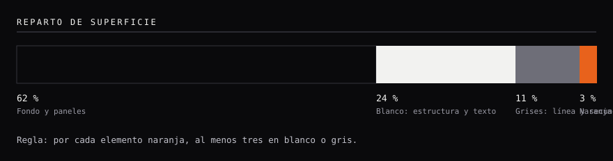</p>


### 3.1.2 Superficies

Cinco superficies oscuras, de la más profunda a la más elevada. «Elevada» no significa sombra: significa **un escalón más claro**.
La profundidad se expresa solo por luminosidad.

<p align="center">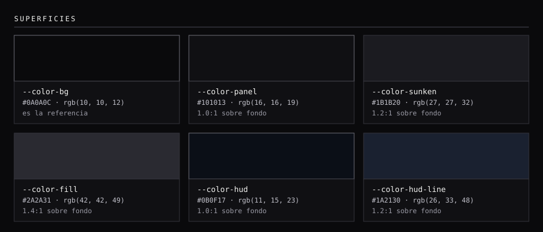</p>


| Muestra | Token | Hex | RGB | Contraste sobre fondo | Nivel WCAG | Uso |
|:--:|---|---|---|--:|:--:|---|
|  | `--color-bg` | `#0A0A0C` | `10, 10, 12` | 1.0:1 | n/a | Fondo de la aplicación. Referencia de todos los contrastes. |
| 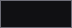 | `--color-panel` | `#101013` | `16, 16, 19` | 1.0:1 | n/a | Superficie 1: tarjetas, bloques de código, avisos y notas. |
|  | `--color-sunken` | `#1B1B20` | `27, 27, 32` | 1.2:1 | n/a | Superficie 2: barras de cabecera de bloque, filas alternas de tabla, `inline-code`, hover de tarjeta. |
| 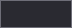 | `--color-fill` | `#2A2A31` | `42, 42, 49` | 1.4:1 | n/a | Superficie 3: hover de botón y de código en línea sobre fila alterna, barra de consola. |
| 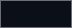 | `--color-hud` | `#0B0F17` | `11, 15, 23` | 1.0:1 | n/a | Fondo del banner HUD. **Desviación registrada** (D-1): matiz azulado. |
| 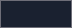 | `--color-hud-line` | `#1A2130` | `26, 33, 48` | 1.2:1 | n/a | Rejilla y filetes del banner HUD. **Desviación registrada** (D-1). |


### 3.1.3 Línea

<p align="center">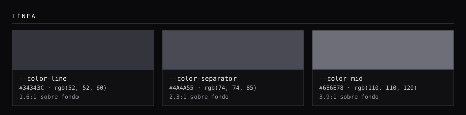</p>


| Muestra | Token | Hex | RGB | Contraste sobre fondo | Nivel WCAG | Uso |
|:--:|---|---|---|--:|:--:|---|
|  | `--color-line` | `#34343C` | `52, 52, 60` | 1.6:1 | n/a | Borde de contenedor y separador interno. Decorativo: no transmite información por sí solo. |
| 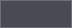 | `--color-separator` | `#4A4A55` | `74, 74, 85` | 2.3:1 | n/a | Separadores estructurales: borde inferior de la cabecera, borde del aside, regla. |
|  | `--color-mid` | `#6E6E78` | `110, 110, 120` | 3.9:1 | n/a | Contorno de chip, tecla `kbd`, marcador de lista, punto de consola. Es la única línea que cumple 3:1. |


> **Nota de accesibilidad.** `--color-line` (1,6:1) y `--color-separator` (2,3:1) son **decorativos**: separan zonas, pero ningún control
> depende de ellos para ser reconocible. Los controles que sí necesitan un límite visible usan `--color-mid` (3,9:1, cumple el mínimo
> de 3:1 para componentes de interfaz) o un relleno.

### 3.1.4 Texto

<p align="center">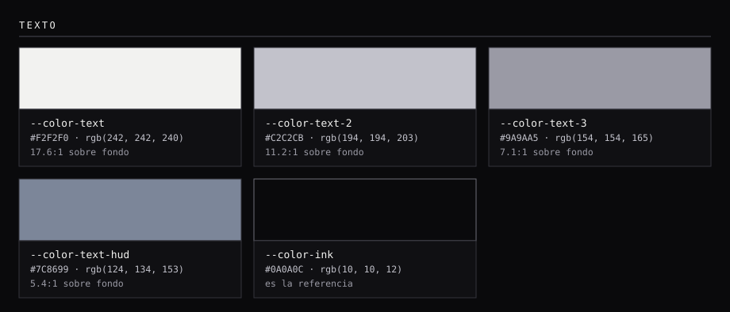</p>


| Muestra | Token | Hex | RGB | Contraste sobre fondo | Nivel WCAG | Uso |
|:--:|---|---|---|--:|:--:|---|
| 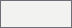 | `--color-text` | `#F2F2F0` | `242, 242, 240` | 17.6:1 | AAA | Texto principal, títulos, cifras y estructuras (cajas, barras, contornos). |
| 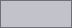 | `--color-text-2` | `#C2C2CB` | `194, 194, 203` | 11.2:1 | AAA | Cuerpo secundario, enlaces de navegación, texto de nota y aviso. |
| 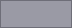 | `--color-text-3` | `#9A9AA5` | `154, 154, 165` | 7.1:1 | AAA | Metadatos, etiquetas, números de línea, leyendas. Mínimo permitido para texto. |
| 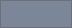 | `--color-text-hud` | `#7C8699` | `124, 134, 153` | 5.4:1 | AA | Texto del banner HUD. **Desviación registrada** (D-1). |
|  | `--color-ink` | `#0A0A0C` | `10, 10, 12` | 1.0:1 | n/a | Texto sobre superficie clara (`--color-text`) o naranja. Contraste sobre naranja: **5.8:1**; sobre blanco: **17.6:1**. |


**Regla de uso.** Cuerpo y títulos en `--color-text`; texto de apoyo en `--color-text-2`; metadatos y etiquetas en `--color-text-3`.
**No existe un cuarto nivel de texto**: el mínimo permitido (`--color-text-3`) ya cumple AA sobre la superficie más clara que
soporta texto (`--color-sunken`).

### 3.1.5 Acento

<p align="center">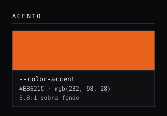</p>


| Muestra | Token | Hex | RGB | Contraste sobre fondo | Nivel WCAG | Uso |
|:--:|---|---|---|--:|:--:|---|
| 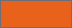 | `--color-accent` | `#E8621C` | `232, 98, 28` | 5.8:1 | AA | Señal. Marca **uno** de los elementos de un grupo; nunca el grupo entero ni la estructura. |


El naranja `#E8621C` es el **único** color de señal. Usos permitidos: barra de acento, cuadrado de título de sección, número de módulo
en el aside, borde del aviso, pestaña activa, foco de teclado, etiqueta `ERROR`, chip de recuento y pastillas del banner.
Usos prohibidos: fondos de página o de tarjeta, texto corrido, bordes de estructura, estados de éxito/peligro.

### 3.1.6 Tema del código

Es la **única zona con color** de la interfaz, junto con las tarjetas JOIN. Basado en _Ayu Mirage_, ajustado para que cada color
alcance como mínimo **AA** sobre `--color-panel`. El color **no sale nunca** del marco: ni en el texto de la página ni en las
tablas. Dentro del código, la jerarquía la hace el color y **todo va a peso 400**.

<p align="center">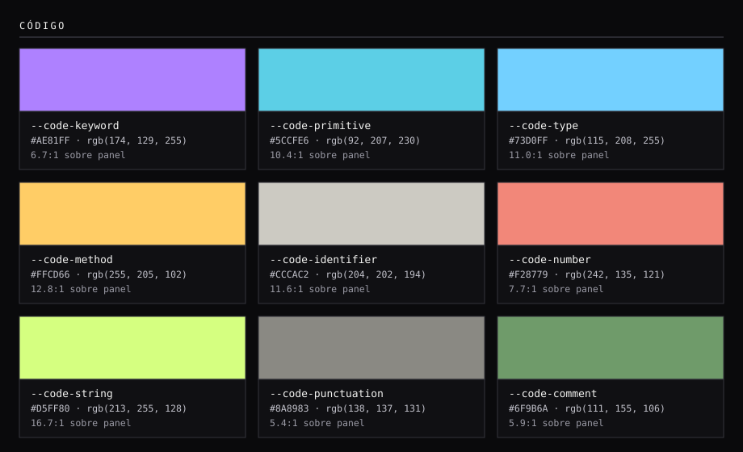</p>


| Muestra | Token | Hex | RGB | Contraste sobre panel | Nivel WCAG | Uso |
|:--:|---|---|---|--:|:--:|---|
| 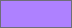 | `--code-keyword` | `#AE81FF` | `174, 129, 255` | 6.7:1 | AA | `class`, `public`, `SELECT`, `const`, etiquetas HTML. |
| 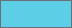 | `--code-primitive` | `#5CCFE6` | `92, 207, 230` | 10.4:1 | AAA | Tipos primitivos: `int`, `double`, `boolean`. |
| 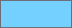 | `--code-type` | `#73D0FF` | `115, 208, 255` | 11.0:1 | AAA | Clases y tipos (`String`), atributos HTML, selectores de clase. |
| 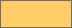 | `--code-method` | `#FFCD66` | `255, 205, 102` | 12.8:1 | AAA | Funciones y métodos: `println()`, `map()`; también títulos. |
| 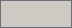 | `--code-identifier` | `#CCCAC2` | `204, 202, 194` | 11.6:1 | AAA | Identificadores y texto por defecto del código. |
| 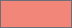 | `--code-number` | `#F28779` | `242, 135, 121` | 7.7:1 | AAA | Números y literales (`42`, `true`, `null`). |
| 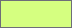 | `--code-string` | `#D5FF80` | `213, 255, 128` | 16.7:1 | AAA | Cadenas de texto. |
|  | `--code-punctuation` | `#8A8983` | `138, 137, 131` | 5.4:1 | AA | Puntuación y operadores: `{ } ( ) ; =`. |
| 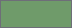 | `--code-comment` | `#6F9B6A` | `111, 155, 106` | 5.9:1 | AA | Comentarios. |


<p align="center">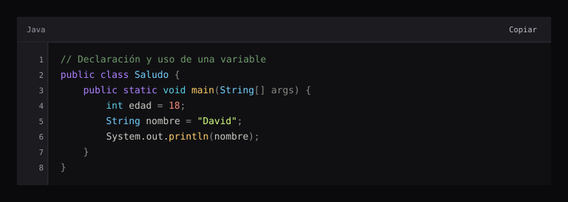</p>


### 3.1.7 Color por tabla (excepción documentada)

En las tarjetas de consulta `JOIN`, cada tabla de la base de datos `tienda_online` tiene su color para que se vea **de qué tabla
viene cada columna** en la consulta, el diagrama y el resultado. Es una excepción acotada al principio 2: **solo existe dentro de
`.join` y de los diagramas**, y nunca sustituye al texto (cada tabla va rotulada con su nombre).

<p align="center">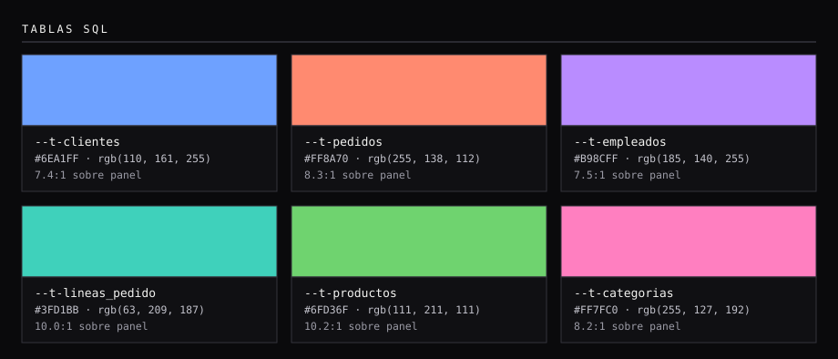</p>


| Muestra | Token | Hex | RGB | Contraste sobre panel | Nivel WCAG | Uso |
|:--:|---|---|---|--:|:--:|---|
| 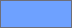 | `--t-clientes` | `#6EA1FF` | `110, 161, 255` | 7.4:1 | AAA | Color de la tabla `clientes` en las tarjetas JOIN: cabecera, clave, aristas y alias. |
| 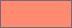 | `--t-pedidos` | `#FF8A70` | `255, 138, 112` | 8.3:1 | AAA | Color de la tabla `pedidos` en las tarjetas JOIN: cabecera, clave, aristas y alias. |
| 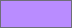 | `--t-empleados` | `#B98CFF` | `185, 140, 255` | 7.5:1 | AAA | Color de la tabla `empleados` en las tarjetas JOIN: cabecera, clave, aristas y alias. |
| 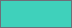 | `--t-lineas_pedido` | `#3FD1BB` | `63, 209, 187` | 10.0:1 | AAA | Color de la tabla `lineas_pedido` en las tarjetas JOIN: cabecera, clave, aristas y alias. |
| 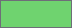 | `--t-productos` | `#6FD36F` | `111, 211, 111` | 10.2:1 | AAA | Color de la tabla `productos` en las tarjetas JOIN: cabecera, clave, aristas y alias. |
| 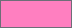 | `--t-categorias` | `#FF7FC0` | `255, 127, 192` | 8.2:1 | AAA | Color de la tabla `categorias` en las tarjetas JOIN: cabecera, clave, aristas y alias. |


### 3.1.8 Resumen de contraste

Los contrastes se calculan con la fórmula de luminancia relativa de WCAG 2.x (`scripts/gen_foundations.py`).

| Par | Contraste | Resultado |
|---|--:|:--:|
| `--color-text` sobre `--color-bg` | 17.6:1 | AAA |
| `--color-text-2` sobre `--color-bg` | 11.2:1 | AAA |
| `--color-text-3` sobre `--color-bg` | 7.1:1 | AAA |
| `--color-text-3` sobre `--color-sunken` (peor caso) | 6.2:1 | AA |
| `--color-accent` sobre `--color-bg` | 5.8:1 | AA |
| `--color-ink` sobre `--color-accent` (chips, pastillas) | 5.8:1 | AA |
| `--color-ink` sobre `--color-text` (botón Ejecutar, cabecera de tabla) | 17.6:1 | AAA |
| Peor color de código sobre `--color-panel` (`--code-punctuation`) | 5.4:1 | AA |

---

## 3.2 Tipografía

Una sola familia, **Fira Code** (monoespaciada), en pesos **400** y **500**. Se sirve autoalojada en `vendor/fonts/` (WOFF2, licencia
SIL OFL 1.1), con `font-display: swap` y pila de reserva `"DejaVu Sans Mono", ui-monospace, monospace`.

<p align="center">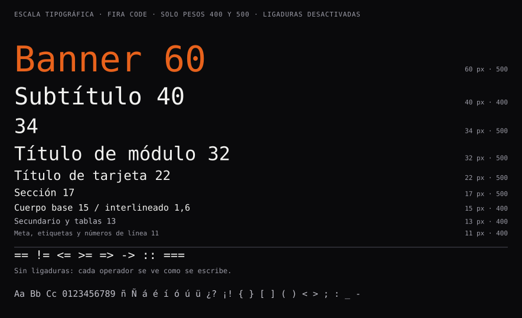</p>


| Rol | Tamaño | Peso | Interlineado | Uso |
|---|--:|:-:|:-:|---|
| Título del banner | `clamp(34px, 7vw, 60px)` | 500 | 1,05 | Nombre en naranja. |
| Subtítulo del banner | `clamp(22px, 4.2vw, 40px)` | 400 | 1,05 | `// 1.º DAW`, en blanco. |
| Título de módulo | `clamp(22px, 3.2vw, 32px)` | 500 | 1,2 | Un `h1` por página. |
| Título de tarjeta | 22 px | 500 | n/a | Tarjeta de temario. |
| Título de sección | 17 px | 500 | 1,35 | `h2`, con cuadrado naranja. |
| Subapartado | 15 px | 500 | 1,35 | `h3`, con cuadrado vacío. |
| **Cuerpo** | **15 px** | 400 | **1,6** | `--font-size-base`; ancho máximo de línea `70ch`. |
| Secundario / tablas / código en línea | 13 a 14 px | 400 | 1,5 | |
| Código (bloques y editores) | 13,5 px | 400 | 22 px fijo | Interlineado fijo para alinear con los números de línea. |
| Meta y etiquetas | 11 a 12 px | 400 | n/a | Números de línea, leyendas, `kbd`. |
| Rótulo HUD | 11 a 12 px | 400 | n/a | Mayúsculas con `letter-spacing` 2,2 a 2,4 px. |

**Reglas**

1. **Ligaduras desactivadas** en toda la web (`font-variant-ligatures: none; font-feature-settings: "liga" 0, "calt" 0`). En código,
   `==`, `!=`, `=>` y `<=` se leen tal cual se escriben; con ligaduras, `==` se dibuja igual que `=`.
2. Dos pesos, nada más. La negrita (`.emphasis`) es peso 500, no 700.
3. No hay cursiva en el sistema: el énfasis es peso 500, no inclinación.
4. Las mayúsculas se reservan a rótulos HUD y etiquetas de estado; el texto corrido nunca va en mayúsculas.

---

## 3.3 Retícula y espaciado

<p align="center">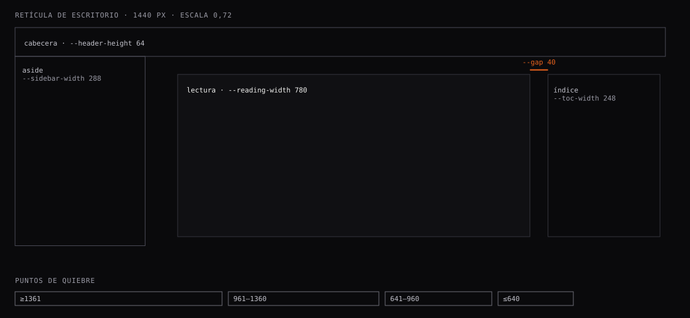</p>


### Tokens de retícula

| Token | Valor | Uso |
|---|--:|---|
| `--header-height` | 64 px (112 px ≤ 960 px) | Cabecera fija; en móvil, dos filas. |
| `--sidebar-width` | 288 px | Aside de módulos. |
| `--toc-width` | 248 px | Índice de la página (columna derecha). |
| `--reading-width` | 780 px | Columna de lectura. |
| `--wide-width` | 1500 px | Portada y páginas de temario (ancho completo). |
| `--gap` | 40 px | Separación entre columnas. |
| `--card-width` / `--card-height` | 360 px / 250 px | Tarjeta de temario (tamaño fijo; el responsive las recoloca). |
| `--cut` | 12 px | Esquina cortada de contenedor. |

### Puntos de quiebre

| Ancho | Comportamiento |
|---|---|
| **≥ 1361 px** | Tres columnas: aside, lectura e índice de la página. |
| **961 a 1360 px** | Se oculta el índice lateral; aside y lectura. |
| **641 a 960 px** | El aside pasa a cajón con velo; la cabecera crece a dos filas (112 px) y aparece «Índice». |
| **≤ 640 px** | Una columna; paginador apilado; botones de cabecera compactos. |

Las tarjetas JOIN responden al **ancho de su propio contenedor** (`container-type: inline-size`), no al de la ventana: así se
recolocan igual en la columna de lectura que en un ancho completo.

### Escala de espaciado

Se usa un conjunto cerrado de valores en píxeles. Un valor fuera de la escala es un defecto, no una elección.

<p align="center">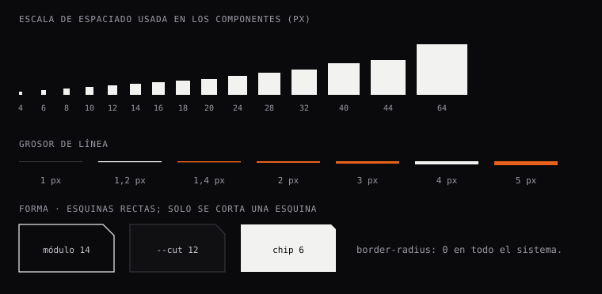</p>


`4 · 6 · 8 · 10 · 12 · 14 · 16 · 18 · 20 · 24 · 28 · 32 · 40 · 44 · 64`

- **Separación entre secciones:** 64 px. Entre bloques de una sección: 18 px. Antes de un subapartado: 36 px.
- **Relleno de contenedor:** 16 a 26 px según el componente (apartado 4).
- **Objetivo táctil mínimo:** 44 px de alto en botones y enlaces de navegación.

---

## 3.4 Línea, forma y profundidad

- **Línea fina.** Grosores: `1`, `1,2`, `1,4`, `2`, `3`, `4` y `5` px. Las barras de acento son de 2 px (reposo) y 3 px (activas).
- **Sin sombras.** La profundidad se logra con escalones de luminosidad (apartado 3.1.2), nunca con `box-shadow` de elevación.
- **Una sola excepción de brillo:** la **barra de acento** (`--glow-bar`) emite un halo naranja al recibir foco o ratón. El brillo
  pertenece a la señal; el contenedor no brilla.
- **Esquinas rectas.** `border-radius: 0` en todo. Para dar carácter se **corta una esquina** (superior derecha) con `clip-path` de 6 px
  en chips y botones numéricos, 12 px en contenedores (`--cut`) y 14 px en el número de módulo.
- **Trama rayada.** El aviso y la franja de sección llevan una trama diagonal de 10 × 10 px. Es el segundo canal (además del color)
  que identifica el aviso.

---

## 3.5 Marca e iconografía

### Logotipo

<p align="center">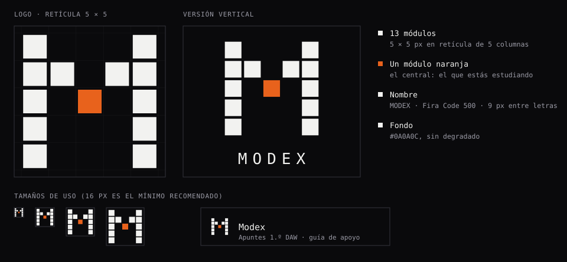</p>


Una **M construida con 13 módulos** cuadrados de 5 × 5 sobre una retícula de 5 columnas. Los módulos son blancos y **el central es naranja**:
el módulo que se está estudiando (principio 2: el naranja marca uno, nunca el grupo). El nombre, **MODEX**, va debajo en Fira Code 500,
en mayúsculas y con 9 px de espaciado entre letras. Sale de _módulo_: la app se organiza en módulos.

| Fichero | Uso |
|---|---|
| `favicon.svg` | Icono de pestaña y marca de la cabecera (solo la M). |
| `assets/modex-logo.svg` | Marca sola. |
| `assets/modex-logo-vertical.svg` | Marca con el nombre debajo; el texto está convertido en trazos, así que no necesita la tipografía instalada. |

Se regeneran con `python scripts/gen_logo.py`. Recomendación: dejar libre alrededor un ancho de módulo y no bajar de 16 px.

### Iconos de temario

<p align="center">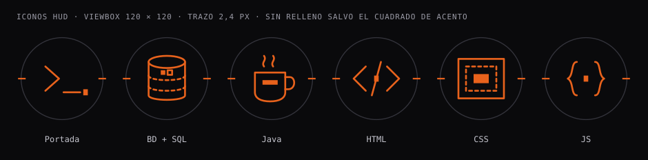</p>


Iconos de línea sobre un círculo de 54 de radio (viewBox 120 × 120): trazo de 2,4 px, extremos redondeados, **sin relleno** salvo el
pequeño cuadrado de acento. Cada temario tiene el suyo (`home`, `sql`, `java`, `html`, `css`, `js`). Se dibujan en línea (SVG
inline en `js/app.js`) para no pedir ficheros extra.

---

## 3.6 Movimiento

| Efecto | Duración | Dónde |
|---|--:|---|
| Cambio de color y de brillo | 150 ms | Barras de acento, enlaces de navegación. |
| Cajón del aside (móvil) | 180 ms | `transform: translateX`. |
| Desplazamiento a ancla | nativo (`scroll-behavior: smooth`) | Enlaces internos. |

**No hay animación decorativa.** Con `prefers-reduced-motion: reduce` se anulan transiciones, animaciones y el desplazamiento suave.

---

## 4. Componentes

Cada componente es **un fichero CSS** en `css/components/` con nombres BEM en inglés (`bloque__elemento--modificador`). La
función que lo genera vive en `js/core.js` (bloques de contenido) o en `js/app.js` (vistas).

> **Hoja única.** Todos los componentes, la marca, el color y la retícula juntos en un solo SVG:
> [`docs/foundations/hoja-de-componentes.svg`](docs/foundations/hoja-de-componentes.svg).

<p align="center"><a href="docs/foundations/hoja-de-componentes.svg">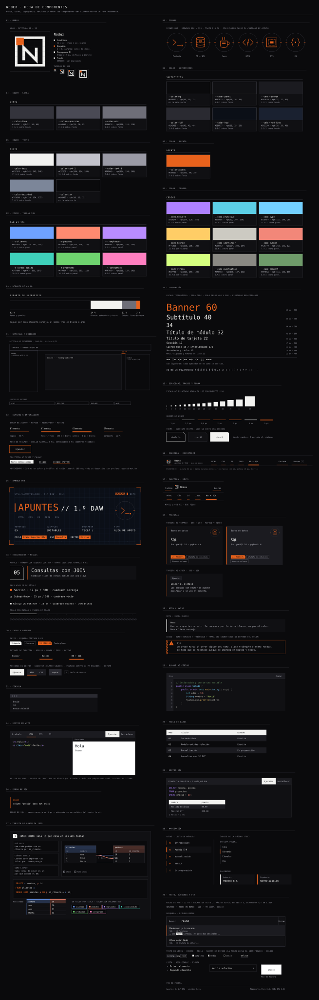</a></p>

### 4.1 Cabecera

<p align="center">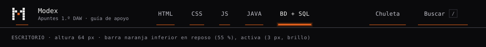</p>

<p align="center">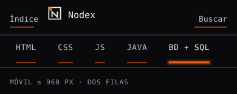</p>


| Parte | Descripción |
|---|---|
| Marca | Logo 32 px + «Modex» (15/500) + eslogan (11/400, `--color-text-3`). En móvil se oculta el eslogan. |
| Temarios | Un enlace por temario, **todos del mismo ancho** (manda el rótulo más largo). Orden: HTML, CSS, JS, Java, BD + SQL. |
| Chuleta | Solo en el temario SQL (`#cheat-link`). Atajo a la chuleta de cálculos. |
| Buscar | Abre el diálogo de búsqueda; tecla `/`. |
| Índice | **Solo móvil (≤ 960 px).** En escritorio el índice ya está en el aside. |

**Estados.** Barra inferior naranja: reposo 55 % · hover/foco 100 % + brillo · activo 3 px + brillo. Fichero: `site-header.css`, `accent-bar.css`.

### 4.2 Banner HUD

<p align="center"></p>


Cabecera de la portada y de cada temario. Anatomía: rejilla de 32 px (`--color-hud-line`), **cuatro corchetes de esquina** naranjas (26 px, 3 px de
trazo), cabecera `SYS://`, franja de trama + bloque de estado, título con barra de 5 px, palabras clave, fila de datos, etiquetas con
pastilla naranja y regla con marcas cada 60 px. Es el único componente que usa los tokens HUD (desviación D-1). Fichero: `banner.css`.

### 4.3 Tarjetas

<p align="center">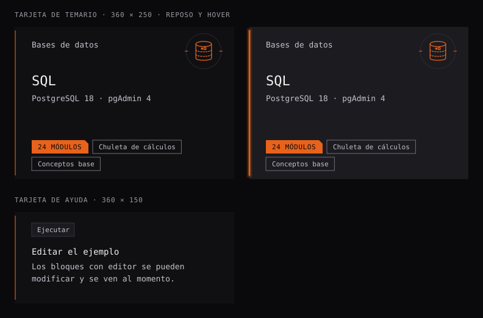</p>


| Variante | Medidas | Contenido |
|---|---|---|
| **Tarjeta de temario** | 360 × 250 | Asignatura, icono 64 px, título 22/500, herramientas, chip de recuento (naranja) y chips de módulos (contorno). |
| **Tarjeta de ayuda** | 360 × 150 | Tecla, título 14/500 y texto 13. |

Barra de acento vertical a la izquierda (2 px, reposo 55 %); en hover/foco la superficie sube a `--color-sunken` y **solo la barra**
brilla. Ficheros: `topic-card.css`, `accent-bar.css`.

### 4.4 Encabezados, reglas y franjas

<p align="center">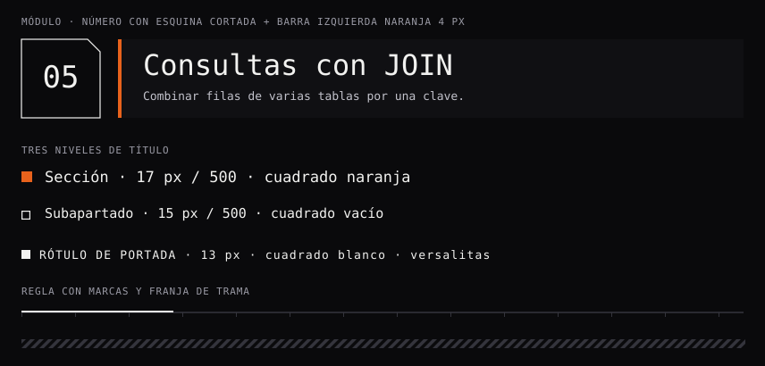</p>


El **número de módulo** (88 × 88, contorno blanco, esquina cortada de 14 px) acompaña a una barra con borde izquierdo naranja de 4 px.
Los tres niveles de título se distinguen por el marcador: cuadrado **naranja** (sección), cuadrado **vacío** (subapartado) y cuadrado
**blanco** con versalitas (rótulo de portada). Ficheros: `module-header.css`, `section.css`, `ruler.css`.

### 4.5 Nota y aviso

<p align="center">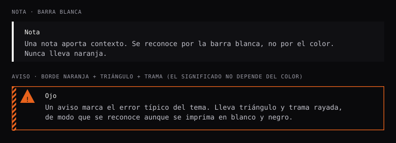</p>


| | Nota | Aviso |
|---|---|---|
| Función | Contexto, truco, importante. | **Error típico del tema.** Cada tema lleva uno y empieza por «Ojo:». |
| Marca | Barra **blanca** de 4 px. | Borde naranja de 1,4 px, **triángulo con «!»** y **trama rayada** de 8 px. |
| Semántica | `<aside class="callout" role="note">` | `<aside class="warning" role="note">` |

El aviso es el ejemplo canónico del principio 3: triángulo y trama transmiten «cuidado» **sin** necesitar el color. Ficheros: `callout.css`.

### 4.6 Chips, botones y teclas

<p align="center">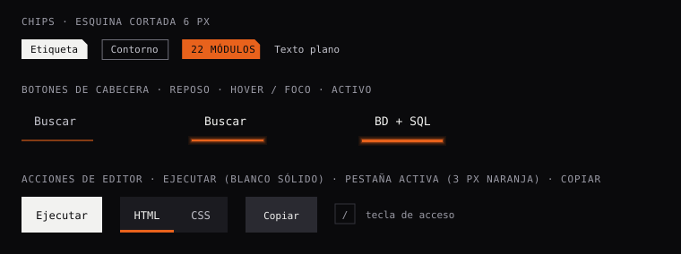</p>


| Pieza | Descripción |
|---|---|
| Chip blanco | Fondo `--color-text`, texto `--color-ink`, esquina cortada de 6 px. |
| Chip contorno | Contorno `--color-mid` de 1 px, texto `--color-text-2`. |
| Chip de acento | Fondo naranja, mayúsculas con 0,6 px de espaciado. **Uno por tarjeta.** |
| Botón de cabecera | Sin relleno; la barra inferior comunica el estado. |
| Botón **Ejecutar** | Relleno blanco sólido, texto `--color-ink`, peso 500. Es la acción principal de un editor. |
| Pestaña activa | Texto blanco + borde inferior naranja de 3 px. |
| `kbd` | Contorno `--color-mid`, texto 0,88 em. |

### 4.7 Bloque de código y consola

<p align="center"></p>

<p align="center">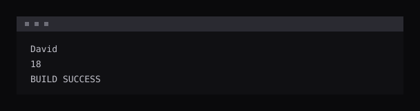</p>


El bloque de código es el único contenedor con **color** (apartado 3.1.6). Anatomía: barra superior (`--color-sunken`, 36 px) con el
lenguaje y el botón **Copiar**; _gutter_ de 44 px con números de línea; cuerpo con desplazamiento horizontal y `tabindex="0"` para que sea
enfocable con teclado. El resaltado lo hace highlight.js y se **reasigna** a los roles del tema por CSS. La consola muestra la salida
esperada en texto secundario, sin color.

### 4.8 Tabla de datos

<p align="center">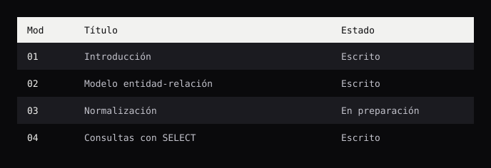</p>


Cabecera **invertida** (fondo `--color-text`, texto `--color-ink`) y filas alternas con `--color-sunken`. Es `role="region"` con
etiqueta y `tabindex="0"` para poder desplazarla con teclado cuando desborda. Fichero: `data-table.css`.

### 4.9 Editores en vivo

<p align="center">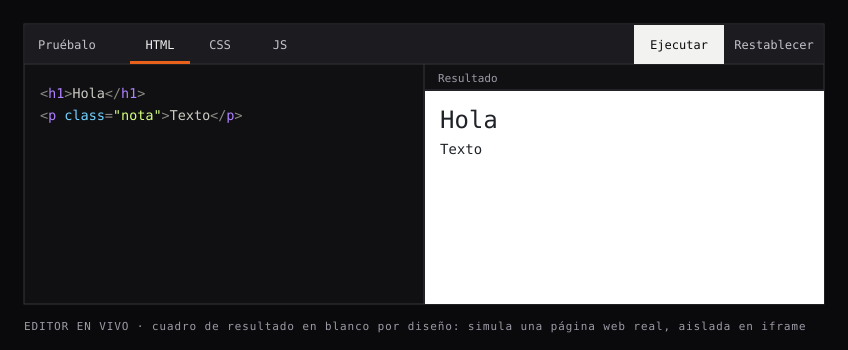</p>

<p align="center">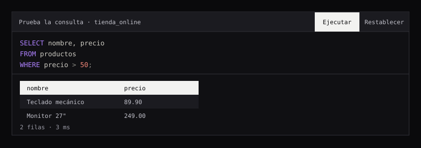</p>

<p align="center">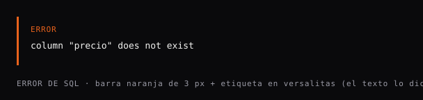</p>


| Editor | Particularidades |
|---|---|
| **HTML/CSS/JS** | Pestañas por lenguaje. Sin JS: actualiza al escribir. Con JS: se ejecuta con **Ejecutar**. El resultado es un `iframe` con `sandbox="allow-scripts"` sobre **fondo blanco** (desviación D-2: simula una página web real). |
| **SQL** | Ejecuta PostgreSQL real en el navegador. Botones: Ejecutar (`Ctrl`+`Intro`), Restablecer, Restablecer BD. Resultado en tabla de datos; máximo 200 filas visibles. |
| **Error** | Barra naranja de 3 px + etiqueta `ERROR` en versalitas: el texto lo dice, no el color. |

Ficheros: `live-editor.css`, `sql-editor.css`.

### 4.10 Tarjeta de consulta JOIN

<p align="center"></p>


Componente propio de las explicaciones de `JOIN`. Cabecera con número (chip blanco), bloques de explicación laterales (_qué hace_, _cuándo usarlo_,
_cómo leerlo_), **diagrama SVG** con las filas reales de la base de datos, consulta con alias coloreados, resultado con cabeceras
teñidas del color de su tabla y una lista de motivos. Las filas sin pareja se marcan con `✕` o `∅` y las celdas `NULL` con trama diagonal:
el significado nunca depende del color. Fichero: `join-viz.css` (usa un _container query_).

### 4.11 Navegación

<p align="center"></p>


| Pieza | Detalle |
|---|---|
| **Aside** (lista de módulos) | Número en naranja + título. Activo: fondo `--color-panel` y barra de 3 px con brillo. Módulo sin escribir: barra al 22 % y texto `--color-text-3`. |
| **Índice de la página** | Filete vertical; el apartado visible lleva borde izquierdo naranja (se actualiza al desplazar). |
| **Paginador** | Dos bloques. «Anterior»: barra **blanca**. «Siguiente»: barra **naranja** (la acción esperada). |
| **Búsqueda** | `<dialog>` modal: entrada de 56 px, resultados con título, módulo y extracto con `<mark>` en blanco/tinta; el resultado seleccionado lleva borde izquierdo naranja. Atajo `/`. |

Ficheros: `sidebar.css`, `toc.css`, `pager.css`, `search-dialog.css`.

### 4.12 Texto, búsqueda y pie

<p align="center"></p>

Migas de pan (enlace en `--color-text-2`, página actual en `--color-text-3`), diálogo de búsqueda, código en línea, tecla, marcas de
estado cuya **forma** lleva el significado, lista, desplegable, figura sobre fondo blanco y pie de página. Ficheros: `breadcrumb.css`,
`search-dialog.css`, `text.css`, `site-footer.css`.

---

## 5. Estados e interacción

<p align="center"></p>


| Estado | Tratamiento |
|---|---|
| Reposo | Barra de acento al 55 % de opacidad. |
| Hover / foco | Barra al 100 % + `--glow-bar`; el texto sube a `--color-text`. |
| Activo | Barra de 3 px + brillo; texto en blanco, peso 500. |
| Pendiente (módulo sin escribir) | Barra al 22 %; texto `--color-text-3`. |
| Foco de teclado | Anillo naranja de 2 px con 2 px de separación. **Nunca se oculta.** |
| Selección de texto | Fondo `--color-text`, texto `--color-ink`. |
| Enlace | Subrayado de 1 px en `--color-mid`; en hover pasa a naranja. |
| Cargando (SQL) | Mensaje de estado en texto; el botón Ejecutar se atenúa y deja de recibir eventos. |

---

## 6. Accesibilidad

El objetivo es **WCAG 2.2 nivel AA** como mínimo.

| Área | Medida |
|---|---|
| Contraste | Todo el texto ≥ 4,5:1 sobre su fondo real, incluidas las superficies `--color-sunken` (apartado 3.1.8). |
| Significado | Nunca solo por color: triángulo y trama (aviso), barra blanca (nota), `✕`/`∅` (fila sin pareja), `ERROR` (error), forma del `status-dot`. |
| Teclado | Todo es operable: saltar al contenido (`skip-link`), búsqueda con `/`, `Ctrl`+`Intro` en SQL, Esc cierra el diálogo; las regiones desplazables llevan `tabindex="0"`. |
| Foco | Anillo naranja de 2 px, siempre visible. |
| Lectores de pantalla | HTML semántico (`header`, `nav`, `main`, `aside`, `section`, `article`, `figure`); `aria-label` en regiones; `aria-live="polite"` en resultados; `sr-only` para textos de apoyo; los iconos decorativos son `aria-hidden`. |
| Objetivos táctiles | 44 px de alto mínimo en navegación y botones. |
| Movimiento | `prefers-reduced-motion` anula transiciones. |
| Zoom y desbordes | Contenedores fluidos; el código y las tablas desbordan en horizontal con desplazamiento enfocable, nunca se truncan. |
| Impresión | Se ocultan cabecera, aside, índice, paginador y botones; fondo blanco y texto negro. |

---

## 7. Contenido y voz

- **Idioma:** español de España. Tuteo. Frases cortas.
- **Tono:** de compañero que explica, no de manual. Se define cada término la primera vez que aparece.
- **Código real:** todo ejemplo es ejecutable y realista; nada de pseudocódigo. Los operadores pertenecen al lenguaje declarado
  (Java no tiene `===`; JavaScript no tiene `.equals()`).
- **Un aviso por tema** con el error típico, en una línea que empieza por «Ojo:».
- **Versiones:** si algo depende de la versión (Java 21 LTS, PostgreSQL 18, ES2024…), se dice.
- **Etiquetas de interfaz:** verbo en infinitivo o sustantivo breve («Ejecutar», «Copiar», «Restablecer», «Buscar»).

---

## 8. Gobierno y versionado

### 8.1 Desviaciones registradas

Una **desviación** es una excepción consciente a un principio. Se documenta aquí o no existe.

| ID | Desviación | Principio afectado | Justificación | Alcance |
|:-:|---|---|---|---|
| D-1 | Tokens `--color-hud`, `--color-hud-line`, `--color-text-hud` (matiz azulado). | 2 | Da carácter de instrumento al banner sin añadir un segundo acento. | Solo `banner.css`. |
| D-2 | Resultado del editor HTML/CSS/JS en **blanco** (`#FFF`). | 2 | Simula una página real; el ejemplo debe verse como lo vería un navegador. | Solo `live-editor__frame`. |
| D-3 | Seis colores por tabla (`--t-*`). | 2 | Hacer visible el origen de cada columna en un `JOIN`. | Solo `.join`, `.ac` y diagramas. |
| D-4 | Tema de color del código. | 2 | Un código sin resaltado es ilegible; el color queda **dentro** del marco. | Solo `.code-block`, editores y `.join__sql`. |
| D-5 | Brillo (`--glow-bar`). | 4 | Refuerza la señal de foco sin decorar el contenedor. | Solo barras de acento. |

### 8.2 Cómo se añade un token

1. Comprobar que **ningún token existente sirve** (aprovechar la escala de espaciado y la paleta).
2. Añadirlo a `css/tokens.css` con comentario de uso.
3. Si es un color: calcular el contraste (`python scripts/gen_foundations.py`) y registrarlo en el apartado 3.1.
4. Si es una desviación: añadir una fila a la tabla 8.1.
5. Regenerar los SVG y actualizar este documento.

### 8.3 Cómo se añade un componente

1. Un fichero en `css/components/<nombre>.css`, dentro de `@layer components`, con nombres BEM en inglés.
2. Solo tokens: ningún color ni medida «suelta» si existe un token o un valor de la escala.
3. Estados de foco, hover y teclado definidos desde el principio.
4. Comprobar el comportamiento en los cuatro puntos de quiebre.
5. Documentarlo en el apartado 4 con su dibujo SVG.

### 8.4 Lista de comprobación de revisión

- [ ] ¿Hay **tres elementos blancos o grises por cada naranja**? ¿El naranja marca _uno_ del grupo?
- [ ] ¿Se entiende en escala de grises? (principio 3)
- [ ] ¿Texto ≥ 4,5:1 sobre su fondo real?
- [ ] ¿Todo valor sale de `tokens.css` o de la escala de espaciado?
- [ ] ¿Sin sombras, degradados, esquinas redondeadas ni emojis?
- [ ] ¿Foco visible y operable con teclado?
- [ ] ¿Se ve bien a 1440, 1100, 800 y 390 px?
- [ ] ¿El color queda dentro del marco de código o de la tarjeta JOIN?
- [ ] ¿Está documentado aquí?

### 8.5 Versionado

Este documento sigue **versionado semántico**: _mayor_ cuando cambia un principio o se retira un token; _menor_ cuando se añade un
componente o un token; _parche_ para correcciones de redacción o de medida.

| Versión | Cambios |
|---|---|
| **1.0** | Primera edición normativa: principios, color con muestras, tipografía, retícula, 11 componentes dibujados en SVG, accesibilidad y gobierno. Incluye el contraste reforzado del texto secundario (`--color-text-2` `#C2C2CB`, `--color-text-3` `#9A9AA5`), el color por tabla y la marca Modex. |

---

## 9. Apéndices

### 9.1 Inventario de tokens

| Familia | Tokens |
|---|---|
| Superficie | `--color-bg`, `--color-panel`, `--color-sunken`, `--color-fill`, `--color-hud`, `--color-hud-line` |
| Línea | `--color-line`, `--color-separator`, `--color-mid` |
| Texto | `--color-text`, `--color-text-2`, `--color-text-3`, `--color-text-hud`, `--color-ink` |
| Acento | `--color-accent`, `--glow-bar` |
| Código | `--code-keyword`, `--code-primitive`, `--code-type`, `--code-method`, `--code-identifier`, `--code-number`, `--code-string`, `--code-punctuation`, `--code-comment` |
| Tablas SQL | `--t-clientes`, `--t-pedidos`, `--t-empleados`, `--t-lineas_pedido`, `--t-productos`, `--t-categorias` |
| Tipografía | `--font-mono`, `--font-size-base`, `--line-height-base` |
| Retícula | `--header-height`, `--sidebar-width`, `--toc-width`, `--reading-width`, `--wide-width`, `--gap` |
| Tarjetas y forma | `--card-width`, `--card-height`, `--cut` |

### 9.2 Inventario de componentes

| Componente | CSS | Se genera en |
|---|---|---|
| Cabecera, marca, temarios | `site-header.css` | `index.html` + `renderMainNav` |
| Barra de acento | `accent-bar.css` | transversal |
| Banner HUD | `banner.css` | `app.js`: `banner()` |
| Tarjetas | `topic-card.css` | `app.js`: `viewHome()` |
| Cabecera de módulo | `module-header.css` | `app.js`: `moduleHeader()` |
| Secciones y títulos | `section.css` | `core.js`: `APP.section` |
| Reglas y franjas | `ruler.css` | `app.js` |
| Nota / aviso | `callout.css` | `core.js`: bloques `nota`, `aviso` |
| Chips | `chip.css` | `app.js` |
| Texto, listas, `kbd`, figuras, `details` | `text.css` | `core.js` |
| Bloque de código | `code-block.css` | `core.js`: `codeBlock` |
| Consola | `console.css` | `core.js`: `consoleBlock` |
| Tabla de datos | `data-table.css` | `core.js`: `table` |
| Editor en vivo | `live-editor.css` | `editor.js` |
| Editor SQL | `sql-editor.css` | `sql-runner.js` |
| Tarjeta JOIN | `join-viz.css` | `joinviz.js` |
| Aside | `sidebar.css` | `app.js`: `renderSidebar` |
| Índice de página | `toc.css` | `app.js` |
| Paginador | `pager.css` | `app.js` |
| Migas | `breadcrumb.css` | `app.js`: `breadcrumb()` |
| Búsqueda | `search-dialog.css` | `app.js` |
| Pie | `site-footer.css` | `app.js` |

### 9.3 Cómo regenerar las muestras y las piezas

```bash
python scripts/gen_foundations.py
```

El script lee `css/tokens.css` (colores) y `js/app.js` (glifos de los iconos) y escribe `docs/foundations/**/*.svg`. Los SVG no usan
filtros, degradados, `<pattern>`, `clip-path` ni `mask`: el brillo se simula con capas translúcidas y las esquinas cortadas son
polígonos, de modo que se ven igual en GitHub y en cualquier editor vectorial.

> **Limitación conocida.** Las imágenes SVG cargadas con `` no pueden descargar tipografías externas, así que en GitHub el texto
> de los dibujos se muestra con la fuente monoespaciada del sistema en lugar de Fira Code. Las proporciones se calculan con la
> métrica de Fira Code (0,6 em por carácter) y son equivalentes.

### 9.4 Licencias

- **Fira Code**: SIL Open Font License 1.1 (`vendor/fonts/`). El texto de la licencia no está todavía copiado en esa carpeta.
- **highlight.js**: BSD-3-Clause según el proyecto original (`vendor/hljs.js`).
- **PGlite**: Apache-2.0 (`vendor/pglite/LICENSE`).
