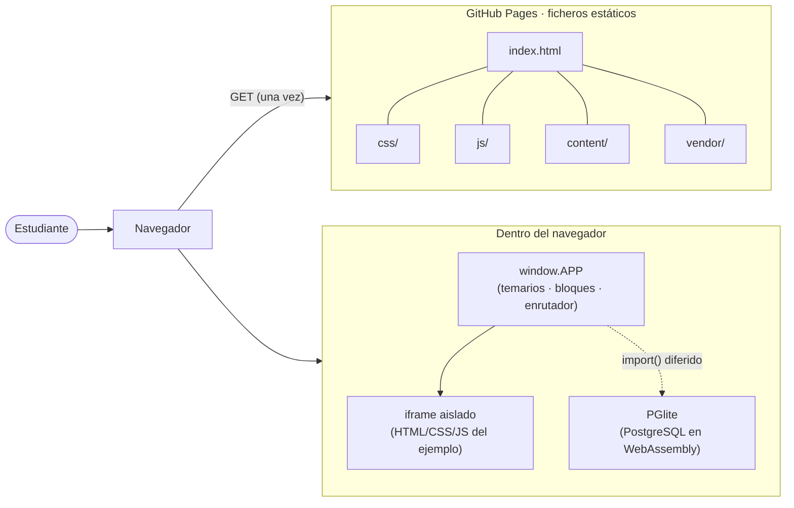
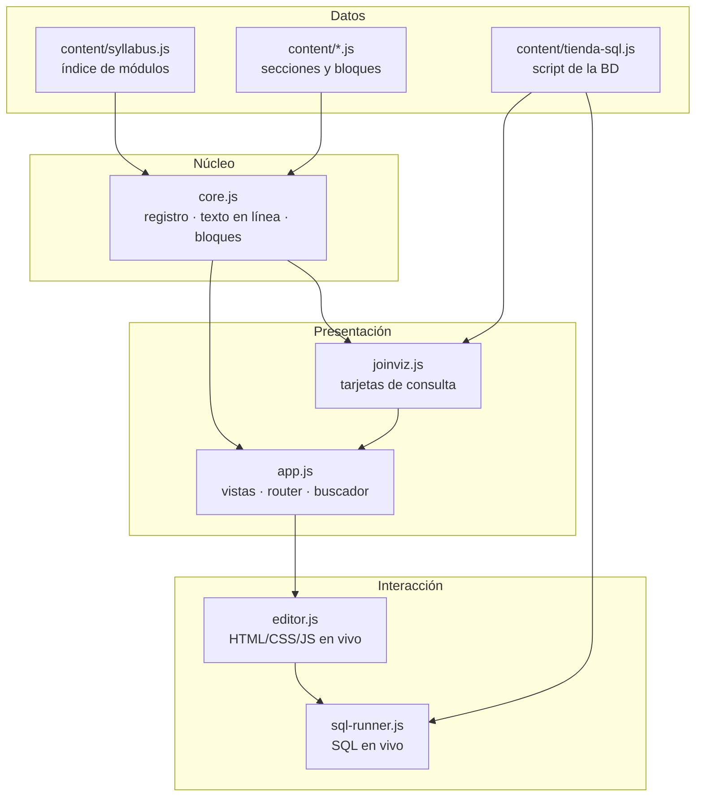
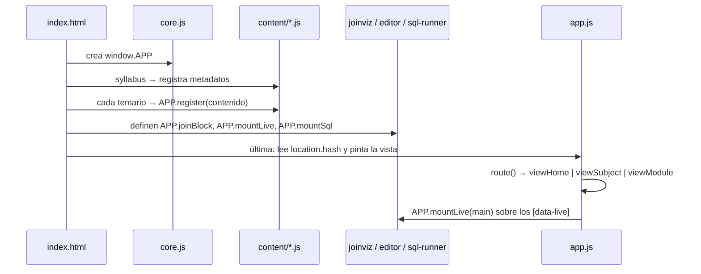
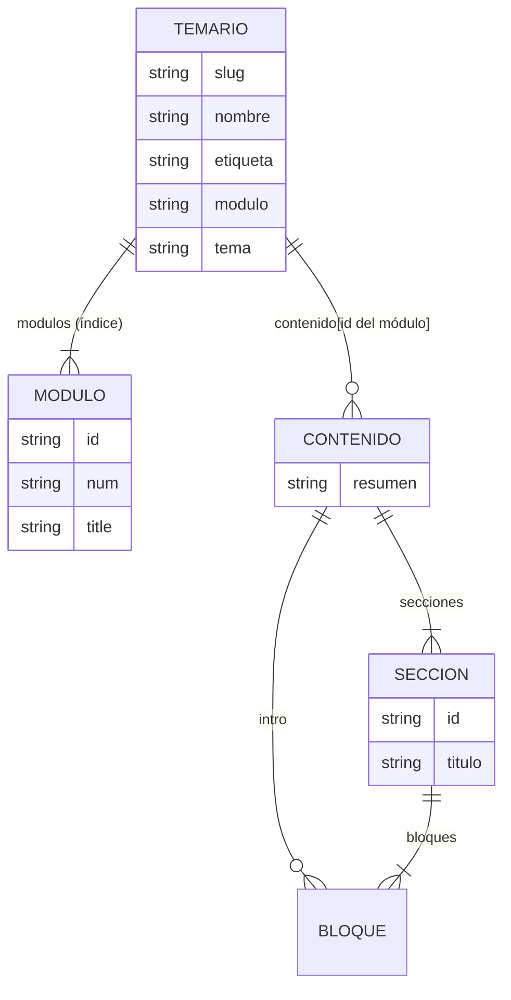
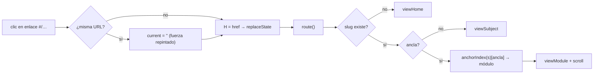
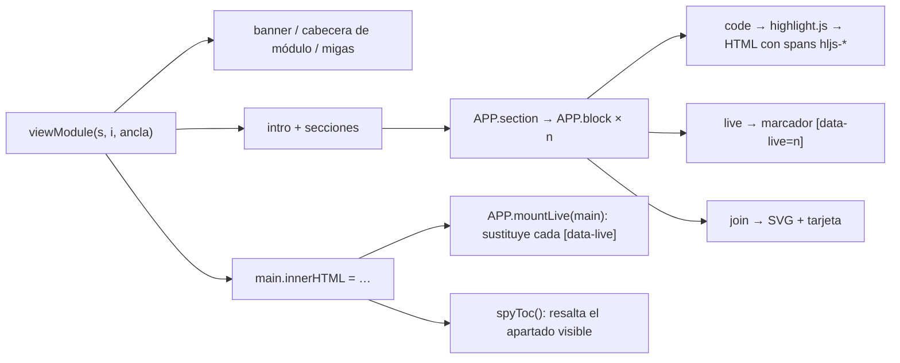
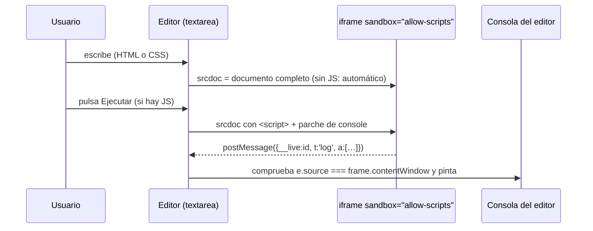
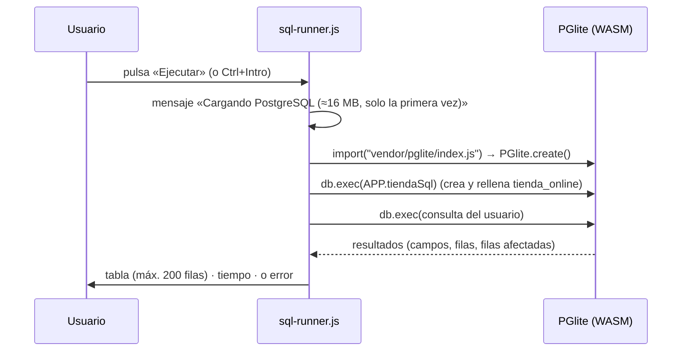
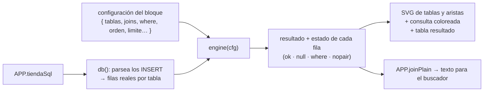
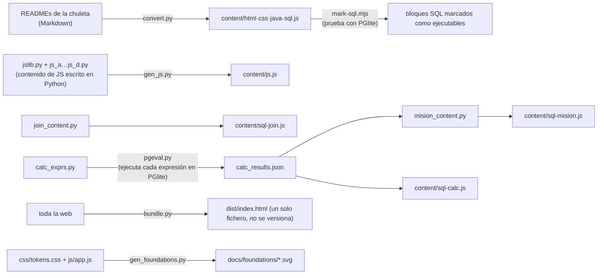

<div align="center">

# Nodex · Wiki técnica

**Estructura, arquitectura e implementación de _Apuntes 1.º DAW_**

`Sitio estático` · `Sin framework ni compilación` · `PostgreSQL real en el navegador (WebAssembly)` · `GitHub Pages`

</div>

> Este documento explica **cómo está construido** el repositorio, **qué hace cada pieza** y, sobre todo, **por qué se hizo así y no de otra
> manera**. Es la referencia para quien vaya a mantener, ampliar o auditar el proyecto. El diseño visual está en
> [`FOUNDATIONS-DESIGN.md`](FOUNDATIONS-DESIGN.md); el uso básico, en [`README.md`](README.md).

---

## Índice

1. [Resumen ejecutivo](#1-resumen-ejecutivo)
2. [Estructura del repositorio](#2-estructura-del-repositorio)
3. [Arquitectura](#3-arquitectura)
4. [Arranque y orden de carga](#4-arranque-y-orden-de-carga)
5. [Modelo de contenido](#5-modelo-de-contenido)
6. [Enrutado](#6-enrutado)
7. [Renderizado](#7-renderizado)
8. [Buscador](#8-buscador)
9. [Editores en vivo (HTML, CSS y JS)](#9-editores-en-vivo-html-css-y-js)
10. [SQL en el navegador](#10-sql-en-el-navegador)
11. [Tarjetas de consulta: el motor `joinviz`](#11-tarjetas-de-consulta-el-motor-joinviz)
12. [Arquitectura CSS](#12-arquitectura-css)
13. [Accesibilidad, rendimiento y seguridad](#13-accesibilidad-rendimiento-y-seguridad)
14. [Pipeline de autor (`scripts/`)](#14-pipeline-de-autor-scripts)
15. [Verificación y calidad](#15-verificación-y-calidad)
16. [Despliegue](#16-despliegue)
17. [Decisiones de arquitectura (por qué así y no de otra forma)](#17-decisiones-de-arquitectura)
18. [Limitaciones conocidas y deuda técnica](#18-limitaciones-conocidas-y-deuda-técnica)
19. [Guía de contribución](#19-guía-de-contribución)
20. [Glosario](#20-glosario)

---

## 1. Resumen ejecutivo

**Qué es.** Una guía de estudio de 1.º de Desarrollo de Aplicaciones Web (Grado Superior, España) con cinco temarios —HTML, CSS,
JavaScript, Java y SQL— publicada como web estática. Los ejemplos de HTML/CSS/JS se editan y se ven al instante; el SQL se ejecuta
contra una base de datos PostgreSQL real **dentro del navegador**.

**Para quién.** Un estudiante que la consulta mientras programa. De ahí los requisitos que mandan sobre todo lo demás: carga
inmediata, buscador rápido, lectura cómoda y cero fricción (sin cuentas, sin instalaciones, sin servidor).

**Restricciones de partida.**

| Restricción | Consecuencia de diseño |
|---|---|
| Alojamiento gratuito (GitHub Pages): solo ficheros estáticos | No hay backend. Todo ocurre en el navegador. |
| Mantenimiento por una sola persona | Pocas piezas, ninguna cadena de compilación, convenciones estrictas. |
| El contenido es el producto | El contenido es **dato** estructurado, separado del código que lo dibuja. |
| Debe enseñar PostgreSQL, no «un SQL» | Motor real de PostgreSQL (PGlite), no un sustituto. |

**Cifras** (medidas sobre el código actual):

| Concepto | Valor |
|---|--:|
| Temarios | 5 (HTML 16 · CSS 19 · JS 18 · Java 14 · SQL 24 módulos) |
| Módulos escritos | **91** de 91 |
| Secciones / bloques de contenido | 461 / 1 377 |
| Editores en vivo incrustados | 258 |
| Tarjetas de consulta JOIN | 17 |
| JS de la aplicación (sin librerías) | ≈ 1 000 líneas en 5 ficheros |
| CSS | ≈ 1 600 líneas: 4 ficheros globales + 22 componentes |
| Contenido (datos) | ≈ 770 kB sin comprimir |
| Motor SQL (PGlite) | ≈ 17 MB en disco, **carga diferida**: solo si se pulsa «Ejecutar» |
| Dependencias de ejecución | 0 por red · 3 terceros copiados en `vendor/` (tipografía, resaltado y motor SQL) |

---

## 2. Estructura del repositorio

```text
.
├── index.html                  ← única página; esqueleto + orden de carga de los scripts
├── favicon.svg                 ← logo Nodex (cuadrado, nodo naranja, monograma N)
├── README.md                   ← presentación y arranque rápido
├── FOUNDATIONS-DESIGN.md       ← sistema de diseño normativo (con muestras SVG)
├── WIKI.md                     ← este documento
├── package.json                ← solo para regenerar contenido SQL (no se necesita para ver la web)
├── .nojekyll                   ← desactiva Jekyll en GitHub Pages
├── .gitignore                  ← __pycache__/, dist/
│
├── css/
│   ├── main.css                ← punto de entrada: declara las capas y hace @import de todo
│   ├── tokens.css              ← variables de diseño (color, retícula, tamaños)  ◄── fuente de verdad
│   ├── base.css                ← @font-face, reinicio, foco, selección, movimiento reducido
│   ├── layout.css              ← rejilla de página y puntos de quiebre
│   └── components/             ← 22 ficheros, uno por componente (BEM)
│
├── js/                         ← la aplicación (scripts clásicos, sin módulos ni bundler)
│   ├── core.js                 ← APP, registro de temarios, texto en línea, dibujo de bloques
│   ├── app.js                  ← vistas, enrutador, buscador, cabecera, copiar código
│   ├── editor.js               ← editor en vivo HTML/CSS/JS con iframe aislado
│   ├── sql-runner.js           ← editor SQL sobre PGlite
│   └── joinviz.js              ← motor y dibujo de las tarjetas de consulta con color por tabla
│
├── content/                    ← los temarios como datos (módulos → secciones → bloques)
│   ├── syllabus.js             ← índice de módulos de cada temario
│   ├── html-00-01.js html.js css.js js.js java.js sql.js
│   ├── sql-join.js             ← módulo 12: JOIN con tarjetas de color por tabla  (generado)
│   ├── sql-calc.js             ← módulo CH: chuleta de cálculos                   (generado)
│   ├── sql-mision.js           ← módulo 21: misiones de consultas                 (generado)
│   └── tienda-sql.js           ← script de la BD de práctica «tienda_online»
│
├── vendor/                     ← terceros copiados al repositorio (versión fija)
│   ├── fonts/                  ← Fira Code 400 y 500 (WOFF2)
│   ├── hljs.js                 ← highlight.js
│   └── pglite/                 ← PostgreSQL compilado a WebAssembly (+ LICENSE)
│
├── scripts/                    ← herramientas de autor (Python / Node), no forman parte de la web
│   ├── convert.py  mark-sql.mjs  bundle.py
│   ├── jslib.py  js_a.py … js_d.py  gen_js.py
│   ├── join_content.py  mision_content.py  calc_exprs.py  calc_results.json  pgeval.py
│   ├── verify_join.py
│   └── gen_foundations.py      ← genera las muestras y piezas SVG de FOUNDATIONS-DESIGN.md
│
└── docs/foundations/           ← SVG generados (swatches/, palettes/, components/)
```

**Regla de oro de la estructura:** *lo que se sirve* (`index.html`, `css/`, `js/`, `content/`, `vendor/`, `favicon.svg`) es independiente
de *lo que se usa para producirlo* (`scripts/`, `package.json`). La web nunca importa nada de `scripts/` ni de `docs/`.

---

## 3. Arquitectura

### 3.1 Vista de contexto

Todo el sistema vive en el navegador de la persona usuaria. No existe ningún servidor propio ni ninguna llamada a una API.



### 3.2 Capas lógicas



| Capa | Responsabilidad | Regla |
|---|---|---|
| **Datos** (`content/`) | Qué se enseña. | Solo datos: ningún HTML ni lógica de presentación. |
| **Núcleo** (`core.js`) | Cómo se convierte un dato en HTML. | Funciones de «dato → cadena HTML». No tocan el DOM de la página. |
| **Presentación** (`app.js`, `joinviz.js`) | Páginas, navegación y piezas compuestas. | Escribe el DOM una vez por vista. |
| **Interacción** (`editor.js`, `sql-runner.js`) | Lo que el usuario puede ejecutar. | Se monta **después** de pintar, sobre `[data-live]`. |

### 3.3 Espacio de nombres único: `window.APP`

Un solo objeto global agrupa toda la aplicación. Es una decisión consciente (apartado 17, AD-2): permite scripts clásicos, un único
orden de carga y un empaquetado trivial.

| Miembro | Definido en | Función |
|---|---|---|
| `APP.subjects`, `APP.order` | `core.js` | Temarios registrados y su orden en la cabecera (`html, css, js, java, sql`). |
| `APP.register(s)` | `core.js` | Combina _metadatos_ (syllabus) y _contenido_ (cada fichero) de un mismo temario. |
| `APP.inline`, `APP.textOnly`, `APP.esc`, `APP.norm` | `core.js` | Texto en línea, texto plano, escape HTML y normalización para búsqueda. |
| `APP.block`, `APP.section`, `APP.plain` | `core.js` | Un bloque → HTML; una sección → HTML; un bloque → texto para el buscador. |
| `APP._live`, `APP._codes` | `core.js` | Colas de configuraciones de editores y de textos para «Copiar». |
| `APP.mountLive`, `APP.mountSql` | `editor.js`, `sql-runner.js` | Convierten marcadores `[data-live]` en editores. |
| `APP.tiendaSql` | `tienda-sql.js` | Script SQL de la base de datos de práctica. |
| `APP.tienda`, `APP.joinEngine`, `APP.joinBlock`, `APP.joinPlain` | `joinviz.js` | Datos de tablas, motor, dibujo y texto plano de las tarjetas JOIN. |

---

## 4. Arranque y orden de carga

`index.html` contiene el esqueleto (cabecera, aside, `<main>`, diálogo de búsqueda) y carga los scripts en este orden, que **es
significativo**:

```text
vendor/hljs.js → js/core.js → content/syllabus.js → content/html-00-01.js, html.js, css.js, js.js, java.js,
sql.js, sql-join.js, sql-calc.js, sql-mision.js → content/tienda-sql.js → js/joinviz.js → js/editor.js →
js/sql-runner.js → js/app.js
```



**Por qué este orden.** `core.js` define `APP` y debe ir primero. El `syllabus` declara los módulos de cada temario; los ficheros de
contenido **se fusionan** sobre esa entrada (`register` hace `Object.assign` y mezcla `contenido`), por lo que un temario puede
repartirse en varios ficheros (SQL: base + JOIN + cálculos + misiones). `joinviz`, `editor` y `sql-runner` solo definen funciones;
`app.js` va el último porque es el único que **actúa** al cargarse (`route()`).

---

## 5. Modelo de contenido

### 5.1 Jerarquía



```js
APP.register({ slug: "sql", nombre: "SQL", etiqueta: "BD + SQL", modulo: "Bases de datos", tema: "PostgreSQL 18 · pgAdmin 4",
  modulos: [ { id: "mod-09", num: "09", title: "SELECT básico" }, /* … */ ] });

APP.register({ slug: "sql", contenido: { "mod-09": {
  resumen: "…",
  secciones: [ { id: "select-basico", titulo: "…", bloques: [ { p: "…" }, { code: "SELECT 1;", lang: "sql" } ] } ]
} } });
```

Un módulo **sin** `contenido` se muestra en el índice como «en preparación» (barra al 22 %, sin enlace). Los identificadores de
módulo (`mod-09`) y de sección son **anclas estables**: forman la URL (`#/sql/select-basico`) y las usa el buscador.

### 5.2 Tipos de bloque

Cada bloque es un objeto con **una** clave que lo identifica. `APP.block` decide por la primera que encuentra.

| Clave | Genera | Datos adicionales |
|---|---|---|
| `p` | Párrafos (separados por línea en blanco) | — |
| `h4` | Subapartado (`<h3 class="subhead">`) | — |
| `code` | Bloque de código resaltado con números de línea y «Copiar» | `lang`, `titulo` |
| `consola` | Salida de consola | — |
| `tabla` | Tabla de datos accesible | `{ cabs, filas, titulo }` |
| `lista` | Lista (`ul`/`ol`) | `ordenada` |
| `nota` | Nota (barra blanca) | `tipo`: `note`, `tip`, `important` |
| `aviso` | Aviso con triángulo y trama | `tipo`: `warning` («Ojo»), `caution` («Cuidado») |
| `sub` | Texto pequeño de apoyo | — |
| `live` | Editor en vivo (HTML/CSS/JS o SQL) | `{ html, css, js, sql, titulo, alto, manual }` |
| `join` | Tarjeta de consulta con color por tabla, o `"mapa"` / `"leyenda"` | ver apartado 11 |
| `img` | Figura con pie | `alt`, `caption` |
| `details` | Desplegable | `{ titulo, bloques }` (anidan bloques) |

### 5.3 Sintaxis en línea

El texto de cualquier bloque admite una micro-sintaxis (`APP.inline`):

| Escribo | Obtengo |
|---|---|
| `` `código` `` | `<code class="inline-code">` |
| `**negrita**` | `<strong class="emphasis">` (peso 500) |
| `{{Ctrl}}` | `<kbd class="key">` |
| `[[ok]]` `[[half]]` `[[no]]` | Marca de estado cuya **forma** (relleno completo, medio o vacío) lleva el significado |
| `[texto](@id-de-seccion)` | Enlace interno al ancla |
| `[texto](https://…)` | Enlace externo (`target="_blank" rel="noopener"`) |
| `((clientes\|texto))` | Texto subrayado con el color de la tabla `clientes` |

**Seguridad del texto en línea.** Primero se extraen los fragmentos de código (se escapan aparte y se guardan tras marcadores), luego
se escapa **todo** el resto con `esc()` y solo después se sustituye la sintaxis por etiquetas. Ningún texto de contenido llega al DOM sin
escapar.

---

## 6. Enrutado

URLs del tipo `#/<temario>/<ancla>`:

| URL | Vista |
|---|---|
| `#/` | Portada: banner, tarjetas de temarios, ayuda de uso |
| `#/sql` | Índice de módulos del temario (tabla) |
| `#/sql/mod-09` | Módulo completo |
| `#/sql/select-basico` | Módulo que contiene esa sección, **desplazado hasta ella** |



Detalles de implementación:

- **El hash vive en una variable (`H`)**, no solo en `location.hash`. Así la navegación funciona también en contextos donde la barra de
  direcciones no se actualiza (vista previa incrustada, `iframe`). `history.replaceState` se llama dentro de `try/catch`.
- **`anchorIndex(s)`** construye un mapa «id de sección o de módulo → posición del módulo», lo que permite enlazar a cualquier
  sección y abrir el módulo correcto.
- **Pintado condicional**: si ya se está en ese módulo (`current === key`), solo se hace scroll al ancla, sin repintar.
- **Clic delegado**: un único `click` en `document` intercepta los `a[href^="#/"]` (sin `Ctrl`/`⌘`), de modo que los enlaces generados
  dentro del contenido funcionan sin enlazar manejadores.

---

## 7. Renderizado

`app.js` compone vistas con _template strings_ y las asigna a `main.innerHTML` **una sola vez por vista**; `core.js` aporta las
funciones «bloque → HTML».



- **Resaltado de código**: `highlight.js` genera `<span class="hljs-…">`; `code-block.css` **reasigna** cada clase a un rol del tema de
  la marca (`--code-keyword`, `--code-string`…). Se usa el _motor_ de la librería, no su hoja de estilos.
- **Marcadores `[data-live]`**: los editores no se construyen al generar el HTML (es una cadena); se dejan marcadores y `mountLive` los
  convierte después. Así `core.js` sigue siendo «puro».
- **Copiar código**: `APP._codes` guarda el texto original de cada bloque; el botón lleva solo un índice (`data-copy`). El texto no
  viaja por atributos HTML, así que no hay problemas de escape ni de tamaño. Usa `navigator.clipboard` con _fallback_ a `execCommand`.
- **Índice de página (TOC)**: `spyToc` observa el scroll con `requestAnimationFrame` y marca el apartado cuyo encabezado pasó el
  umbral de 140 px.

---

## 8. Buscador

Un `<dialog>` modal (tecla `/` o botón «Buscar»).

1. **Índice en memoria, construido de forma diferida** la primera vez que se abre: una entrada por **sección**
   (`temario · módulo · sección · texto plano normalizado`). El texto plano sale de `APP.plain(bloque)` para cada tipo de bloque
   (incluidos los desplegables, los editores y las tarjetas JOIN).
2. **Normalización** (`APP.norm`): minúsculas y sin diacríticos (`NFD`), de modo que «ejecucion» encuentra «ejecución».
3. **Puntuación**: todos los términos deben aparecer (AND). Cada término suma 20 si está en el título (sección + módulo) y hasta 8 por
   apariciones en el cuerpo. Se muestran los 40 mejores.
4. **Extracto** con el término resaltado (`<mark>`), tras quitar la sintaxis de enlaces del texto indexado.
5. **Teclado**: ↑/↓ mueven la selección, Intro abre, Esc cierra (nativo del `<dialog>`).

La chuleta de cálculos es **fácil de encontrar desde el buscador** (`round`, `coalesce`, `%`, `fecha`…) porque sus tablas se indexan como
texto, y tiene un acceso directo «Chuleta» en la cabecera cuando se está en el temario SQL.

---

## 9. Editores en vivo (HTML, CSS y JS)

`editor.js` monta un editor por cada marcador `[data-live]`.



- **Aislamiento**: `sandbox="allow-scripts"` **sin** `allow-same-origin`. El código del ejemplo corre en un **origen opaco**: no puede leer
  el DOM de la aplicación, ni cookies, ni `localStorage`. La única vía de salida es `postMessage`.
- **Protocolo de consola**: dentro del iframe se inyecta un script que envuelve `console.log/info/warn/error` y escucha `error` y
  `unhandledrejection`; envía `{ __live: id, t, a }` al padre. El padre **verifica** `e.data.__live === id` **y**
  `e.source === frame.contentWindow` antes de aceptar un mensaje.
- **Ejecución manual con JS**: si el ejemplo incluye JavaScript, solo se ejecuta al pulsar **Ejecutar**. Un bucle a medio escribir no
  puede colgar la página mientras se teclea.
- **Sin JS**: la vista se actualiza al escribir, sin pulsar nada.
- **Defensa en el `srcdoc`**: se neutralizan `</script` y `</style` dentro del código del usuario para que no rompan el documento.
- **Restablecer** devuelve el ejemplo original (copia guardada al montar).
- El resultado va sobre **fondo blanco** a propósito (desviación D-2 de `FOUNDATIONS-DESIGN.md`): simula una página real.

---

## 10. SQL en el navegador

`sql-runner.js` usa **PGlite**: PostgreSQL compilado a WebAssembly que corre en el hilo del navegador.



Decisiones de implementación:

- **Carga diferida (`openDb`)**: la base de datos se crea en la **primera** ejecución y la promesa se reutiliza (`dbPromise`). Si falla,
  se descarta para poder reintentar. Quien no ejecuta SQL **no descarga** los ≈ 17 MB.
- **Cola serie (`serial`)**: todas las operaciones sobre la BD pasan por una cadena de promesas. Dos ejemplos pulsados a la vez no
  se pisan.
- **Restablecer BD**: `ROLLBACK` defensivo, `DROP SCHEMA public CASCADE; CREATE SCHEMA public;` y se vuelve a ejecutar el script. Es la red de
  seguridad cuando alguien ejecuta `DROP` o `DELETE` en un ejemplo.
- **Varias sentencias**: `db.exec` devuelve un resultado por sentencia; se pintan todos con su leyenda «Resultado n de m».
- **Formato de valores** (`fmt`): `NULL` se muestra con estilo propio; las fechas a medianoche se muestran como `AAAA-MM-DD`; los objetos
  (JSON) se serializan.
- **Base de datos de práctica `tienda_online`**: `content/tienda-sql.js` contiene el script completo (también pensado para pegar en pgAdmin).
  Tablas: `categorias`, `productos`, `clientes`, `empleados`, `pedidos`, `lineas_pedido`.
- **Ruta del motor**: `APP.pgliteUrl || "vendor/pglite/index.js"`, resuelta contra `document.baseURI`. El empaquetado de un solo fichero
  (`scripts/bundle.py`) sobrescribe esa variable para apuntar a una CDN.

---

## 11. Tarjetas de consulta: el motor `joinviz`

El módulo 12 (JOIN) enseña cada consulta con **un color por tabla**, mostrando de qué tabla viene cada columna y qué filas casan.
Esto exige calcular el resultado real y dibujarlo: lo hace `joinviz.js`.



**De dónde salen los datos.** `db()` recorre `APP.tiendaSql` con una expresión regular sobre las sentencias `INSERT INTO …`, separa las
tuplas y construye las filas de cada tabla. Los datos que se dibujan son, por construcción, **los mismos que ejecuta PGlite**: no hay una
copia que pueda desincronizarse.

**Qué sabe calcular.** `INNER`, `LEFT`, `RIGHT`, `FULL` y `CROSS JOIN`; condición `ON` con filtro adicional (`extra`); filtros `WHERE` con
operadores; agregados (`count`, `sum`, `avg`, `min`, `max`; los importes numéricos se tratan en céntimos para no acumular errores de
coma flotante); expresiones de cálculo; `orden` y `limite`; y cadenas de hasta tres tablas adyacentes.

**Cómo se comunica el estado sin depender del color.** Cada fila del diagrama recibe un estado: `ok` (casa), `null` (queda con `NULL` en
un `LEFT`/`RIGHT`), `where` (descartada por el filtro) o `nopair` (sin pareja). Se dibuja con marcas **de forma**: `✕` y `∅`, aristas
discontinuas y celdas `NULL` con trama diagonal.

**Modos del bloque `join`.** Un objeto de configuración dibuja una tarjeta completa; `"mapa"` dibuja el mapa de claves de la base de
datos; `"leyenda"` dibuja la leyenda de colores por tabla.

**Fidelidad.** El motor es una implementación mínima de la semántica de SQL, así que **se contrasta con PostgreSQL**
(apartado 15): el resultado calculado por `joinviz` para las 42 consultas del contenido es idéntico al de PGlite.

---

## 12. Arquitectura CSS

```css
/* css/main.css */
@layer tokens, base, layout, components, utilities;
@import "tokens.css";
@import "base.css";
@import "layout.css";
@import "components/accent-bar.css";   /* … un @import por componente */
```

| Mecanismo | Decisión |
|---|---|
| **Capas en cascada** (`@layer`) | El orden de las capas decide, no la especificidad: un componente siempre gana a la base. Los componentes se escriben con selectores de una sola clase. |
| **Variables CSS** | Toda medida y color sale de `tokens.css`. No hay valores «sueltos» en los componentes. |
| **BEM en inglés** | `bloque__elemento--modificador`. Un fichero por bloque (`topic-card.css` → `.topic-card`, `.topic-card__title`). Predecible, sin colisiones y sin anidar selectores. |
| **CSS nativo** | Sin Sass, sin PostCSS, sin utilidades. El navegador interpreta los ficheros tal cual. |
| **Consultas de contenedor** | La tarjeta JOIN responde al ancho **de su columna** (`container-type: inline-size`), no al de la ventana. |
| **Responsive** | Tres puntos de quiebre (1360, 960 y 640 px) declarados en `layout.css` y en los componentes que lo necesitan. |
| **Impresión** | `@media print` oculta navegación y deja fondo blanco. |

El detalle visual (paleta, tipografía, componentes, accesibilidad) está en [`FOUNDATIONS-DESIGN.md`](FOUNDATIONS-DESIGN.md).

**Convenciones de nombres.** Las _claves de contenido_ (`bloques`, `secciones`, `consola`) están en español porque son el lenguaje del
dominio (apuntes en español); las _clases CSS_, funciones y ficheros de código están en inglés porque es la convención del sector.

---

## 13. Accesibilidad, rendimiento y seguridad

### Accesibilidad

HTML semántico (`header`, `nav`, `main`, `aside`, `section`, `article`, `figure`), enlace «Saltar al contenido», etiquetas `aria-label`
en regiones, `aria-live="polite"` en resultados, foco visible, regiones desplazables enfocables con teclado, `<dialog>` nativo para la
búsqueda, `prefers-reduced-motion` y significado nunca solo por color. Medidas y contrastes en `FOUNDATIONS-DESIGN.md` (apartado 6).

### Rendimiento

| Técnica | Efecto |
|---|---|
| Sin framework ni _bundle_ | Arranque casi inmediato; se ejecuta solo ≈ 1 000 líneas de JS propio. |
| Una sola escritura de DOM por vista | Sin repintados parciales ni _diffing_. |
| Carga **diferida** del motor SQL | Los ≈ 17 MB solo se descargan si se pulsa «Ejecutar». |
| Tipografía autoalojada, 2 pesos, `font-display: swap` | Texto visible desde el primer instante; 208 kB en total. |
| Índice de búsqueda construido al primer uso | No penaliza la carga. |
| Cero peticiones a terceros en ejecución | Sin latencia externa ni dependencia de una CDN. |

### Seguridad y privacidad

- **Modelo de confianza.** El **contenido lo escribe el autor** (no hay contenido generado por usuarios). Aun así, todo texto se escapa
  antes de pasar a HTML (apartado 5.3).
- **Código del usuario aislado.** Lo que se teclea en un editor se ejecuta en un `iframe` con origen opaco (apartado 9).
- **Sin estado ni red.** La aplicación **no usa** `localStorage`, `sessionStorage`, cookies ni `fetch`; no hay analítica. Lo único que
  se carga dinámicamente es el motor SQL, desde el propio sitio.
- **Los datos del SQL son locales.** PGlite corre en memoria de la pestaña; nada de lo que se ejecuta sale del navegador.

---

## 14. Pipeline de autor (`scripts/`)

El contenido de los temarios grandes **no se escribe a mano en JavaScript**: se produce con scripts reproducibles y se versiona el
resultado. Los scripts no forman parte de la web.



| Script | Qué hace |
|---|---|
| `convert.py` | Conversión inicial (una vez): READMEs en Markdown → `content/<temario>.js` con la estructura de bloques de la app. |
| `mark-sql.mjs` | Marca como ejecutables los bloques SQL que funcionan sobre `tienda_online`, **probándolos de verdad** con PGlite. Requiere `npm i` (`package.json` fija PGlite 0.5.11). |
| `jslib.py`, `js_a.py … js_d.py`, `gen_js.py` | El temario de JS está escrito en Python con funciones auxiliares (`P`, `CODE`, `CON`, `TAB`, `S`, `M`) y se serializa a `content/js.js`. |
| `join_content.py` | Define los bloques JOIN (módulo 12) con funciones (`T`, `CL`, `PE`, `EM`, `J`, `sec`) y genera `content/sql-join.js`. |
| `calc_exprs.py` | Lista de expresiones de la chuleta: texto mostrado, expresión PostgreSQL y explicación. |
| `pgeval.py` | Ejecuta esas expresiones en PGlite (Playwright) y guarda los resultados en `calc_results.json`. |
| `mision_content.py` | Genera misiones (módulo 21) y la chuleta a partir de los resultados; inyecta funciones JS con marcadores `__JS__…__JS__`. |
| `bundle.py` | Empaqueta CSS, JS y fuentes en `dist/index.html` para probarlo sin servidor (carpeta ignorada por git). |
| `verify_join.py` | Contrasta `joinviz` con PostgreSQL (apartado 15). |
| `gen_foundations.py` | Genera las muestras de color y las piezas HUD de `FOUNDATIONS-DESIGN.md` como SVG. |

**Principio.** Un resultado que aparece en pantalla (la salida de una consulta, el valor de `7 / 2`) **se obtiene ejecutándolo**, no
escribiéndolo a mano. Así no puede haber un ejemplo «bonito» que en la práctica dé otra cosa.

---

## 15. Verificación y calidad

La aplicación no tiene _framework_ de pruebas: la verificación está donde el riesgo es mayor.

| Comprobación | Cómo | Qué garantiza |
|---|---|---|
| **Motor JOIN vs PostgreSQL** | `scripts/verify_join.py` abre la web con Playwright, ejecuta en PGlite la consulta de cada bloque `join` y compara con el resultado del motor (se normalizan fechas y números). | Las 42 consultas coinciden fila a fila con PostgreSQL. |
| **SQL ejecutable** | `mark-sql.mjs` solo marca como ejecutables los bloques que se ejecutan sin error. | Ningún ejemplo «Ejecutar» falla por sintaxis. |
| **Resultados de la chuleta** | `pgeval.py` obtiene cada resultado ejecutando la expresión. | Las tablas de resultados son reales. |
| **Render de todos los módulos** | Recorrido de los 91 módulos comprobando que pintan sin excepciones y que los enlaces internos (`@id`) resuelven. | Sin módulos rotos ni enlaces colgantes. |
| **Contraste de color** | `gen_foundations.py` calcula WCAG 2.x para cada token. | El texto cumple AA como mínimo (ver `FOUNDATIONS-DESIGN.md`). |

Para reproducir la verificación del motor JOIN:

```bash
python -m http.server 8777                     # en la raíz del repo
pip install playwright && playwright install chromium
python scripts/verify_join.py                  # en otra terminal
```

> **Comportamiento esperado, no un fallo:** en el temario de JS, el ejemplo del módulo 01 que asigna a una constante lanza
> «Assignment to constant variable» a propósito: es la demostración del error.

---

## 16. Despliegue

| Aspecto | Valor |
|---|---|
| Plataforma | GitHub Pages |
| Origen | Rama `main`, carpeta `/` (raíz) |
| Dirección | https://darogon01.github.io/APP-Apuntes-1DAW/ |
| Compilación | **Ninguna**: se sirven los ficheros tal cual |
| `.nojekyll` | Vacío. Desactiva Jekyll para que no procese ni ignore carpetas (por ejemplo `vendor/` con ficheros que empiezan por guion bajo). |

**Flujo.** `git push` a `main` → GitHub Pages publica en uno o dos minutos. No hay _pipeline_ de integración continua: no hay nada que
compilar. Tras un despliegue conviene **recargar sin caché** (`Ctrl`+`Shift`+`R`) porque el navegador conserva CSS y JS.

**Ver en local.** Hace falta un servidor HTTP (`python -m http.server 8000`): abrir `index.html` con doble clic no permite al navegador
cargar el motor SQL (`import()` de un módulo) por las restricciones de `file://`.

**Documentación en el mismo repositorio.** `README.md`, `FOUNDATIONS-DESIGN.md`, `WIKI.md` y `docs/` se sirven también (como ficheros), pero la
aplicación no los usa.

---

## 17. Decisiones de arquitectura

Formato: **contexto → decisión → alternativas descartadas y motivo → consecuencias**.

### AD-1 · Sitio estático sin framework ni paso de compilación

- **Contexto.** Una guía de consulta mantenida por una persona, alojada gratis, que debe cargar al instante.
- **Decisión.** HTML + CSS nativo + JavaScript sin compilar.
- **Descartado.** _React / Vue / Svelte_: aportan estado reactivo que esta app **no necesita** (cada vista se pinta una vez desde datos
  estáticos) y añaden _build_, dependencias y actualizaciones. _Astro / Next / Eleventy_ (generadores estáticos): resolverían el
  prerrenderizado, pero obligan a una cadena de compilación y a un flujo de despliegue más para un beneficio mínimo (la app ya es rápida y
  el buscador necesita el contenido en cliente de todos modos). _Tailwind / Sass_: ver AD-9.
- **Consecuencias.** (+) Editar un fichero y recargar. Cero dependencias que caduquen. Todo el código cabe en la cabeza de una
  persona. (−) Sin comprobación de tipos, sin reutilización de componentes por herramienta (se compensa con convenciones y funciones
  pequeñas), plantillas como cadenas de texto.

### AD-2 · Scripts clásicos y un único espacio de nombres `window.APP`

- **Decisión.** `<script src>` en orden, cada fichero en una IIFE que cuelga de `APP`. Sin módulos ES.
- **Descartado.** _Módulos ES_ (`import`/`export`): serían correctos, pero obligan a servidor para todo (incluido `dist/`), impiden el
  empaquetado trivial en un solo fichero que se usa para pruebas y obligan a gestionar grafos de importación para una app de 5 ficheros.
  _Bundler (Vite/esbuild)_: reintroduce la compilación (AD-1).
- **Consecuencias.** (+) Orden de carga explícito y legible en `index.html`; el _bundle_ de un solo fichero son unas 30 líneas de Python.
  (−) Acoplamiento por orden de carga y estado global: es un riesgo que se acepta por el tamaño del proyecto y se mitiga con IIFE y un
  solo objeto global.
- **Excepción deliberada.** PGlite sí se importa con `import()` dinámico, porque es un módulo ES de terceros y así se carga bajo demanda.

### AD-3 · El contenido es dato estructurado en JS, no Markdown ni HTML escrito a mano

- **Decisión.** Cada módulo es un objeto con secciones y bloques tipados (apartado 5).
- **Descartado.** _Markdown interpretado en el cliente_ (marked, etc.): el contenido necesita piezas que Markdown no expresa (editor en
  vivo, tarjetas JOIN, avisos tipados, desplegables) y habría que inventar extensiones; además añade una librería y un análisis en cada
  carga. _Markdown compilado a HTML en el _build__: exige compilación (AD-1) y pierde la estructura para el buscador. _HTML escrito a
  mano_: mezcla contenido y presentación, y cualquier rediseño obligaría a tocar cientos de bloques. _JSON y `fetch`_: obliga a servidor y
  a gestionar carga asíncrona y errores.
- **Consecuencias.** (+) Un cambio de diseño se hace en una función de `core.js` y afecta a los 1 377 bloques. El buscador, el índice,
  las anclas y los enlaces internos salen de la propia estructura. Cada bloque sabe devolver su texto plano. (−) Escribir directamente
  los datos es incómodo: por eso existe el _pipeline_ de autor (apartado 14).

### AD-4 · Enrutado por _hash_ (`#/temario/ancla`) en lugar de la API History

- **Contexto.** GitHub Pages no permite reglas de reescritura: una URL como `/sql/mod-09` daría **404** al recargar.
- **Decisión.** Hash, con la ruta guardada además en una variable.
- **Descartado.** _History API_ con ruta real: requiere servidor con _fallback_ a `index.html` o el truco de `404.html`, que genera un
  parpadeo y problemas de indexación. _Una página HTML por módulo_: 91 ficheros duplicando cabecera, aside y scripts, sin navegación
  instantánea.
- **Consecuencias.** (+) Funciona en cualquier alojamiento estático y en vistas previas incrustadas; los enlaces profundos sobreviven
  a la recarga. (−) URLs menos «limpias» y sin posibilidad de _renderizado en servidor_ (irrelevante: no es una web a posicionar, es una
  herramienta de estudio).

### AD-5 · PostgreSQL real en el navegador (PGlite) en lugar de una BD de servidor, SQLite o una simulación

- **Contexto.** Se enseña **PostgreSQL 18**. Los ejemplos usan `::`, `generate_series`, `to_char`, `ILIKE`, `RETURNING`, tipos y
  restricciones propios.
- **Decisión.** PGlite (WASM) con carga diferida.
- **Descartado.** _Servidor propio o BD en la nube_: coste, mantenimiento, seguridad, y ejecutar SQL arbitrario de desconocidos en un
  servidor es un riesgo; además GitHub Pages no lo permite. _SQLite en WASM (sql.js)_: más ligero (< 2 MB), pero **dialecto distinto**:
  enseñaría sintaxis y comportamientos que no existen en PostgreSQL, que es justo lo que el alumno usará. _Un intérprete de SQL
  «de juguete»_: mentiría en cuanto un ejemplo salga del caso previsto. _Capturas de resultados_: no son ejecutables ni editables.
- **Consecuencias.** (+) Resultado idéntico al de pgAdmin; cada alumno tiene su BD privada y desechable; funciona sin conexión una vez
  cargada. (−) ≈ 17 MB la primera vez (se mitiga con carga diferida y aviso explícito) y consumo de memoria de la pestaña.

### AD-6 · Librerías y tipografías copiadas al repositorio (`vendor/`) en lugar de una CDN

- **Decisión.** highlight.js, PGlite y Fira Code se versionan con el proyecto.
- **Descartado.** _CDN_ (jsDelivr, Google Fonts): una caída, un cambio de versión o un bloqueo de red del centro de estudios rompería la
  app; además cada visita enviaría datos a un tercero (privacidad) y se perdería la reproducibilidad.
- **Consecuencias.** (+) Versiones fijas, comportamiento reproducible y sin peticiones externas. (−) Repositorio de ≈ 17 MB por PGlite;
  las actualizaciones son manuales. (Pendiente: copiar los textos de licencia de Fira Code y highlight.js a `vendor/`.)

### AD-7 · El diagrama JOIN se calcula con un motor propio (y se verifica contra PostgreSQL)

- **Decisión.** `joinviz.js` calcula el resultado, el estado de cada fila y dibuja el SVG a partir de los **datos reales**.
- **Descartado.** _Diagramas dibujados a mano_ (SVG/PNG por consulta): 17 tarjetas × varios estados; cualquier cambio en la BD los
  deja obsoletos y no son accesibles. _Capturas de pgAdmin_: no son legibles ni buscables. _Ejecutar PGlite para dibujar_: obligaría a
  descargar 17 MB solo por **ver** la explicación.
- **Consecuencias.** (+) Una explicación ligera, instantánea y coherente con la BD. (−) El motor reimplementa parte de la semántica de SQL:
  riesgo de divergencia, **mitigado** con una verificación automática contra PostgreSQL (apartado 15).

### AD-8 · Los resultados de los ejemplos se obtienen ejecutándolos

- **Decisión.** Las tablas de la chuleta y de las misiones se generan con `pgeval.py`, y los bloques ejecutables se validan con `mark-sql.mjs`.
- **Descartado.** _Escribir a mano los resultados_: es la fuente clásica de errores en material didáctico (un «= 3» que en realidad es
  «3,5»). _Calcular siempre en directo_: obligaría a cargar PGlite para ver una tabla de referencia, y las tablas no serían buscables.
- **Consecuencias.** (+) Las tablas son estáticas (rápidas y buscables) **y** reales. (−) Hay que **regenerar** al cambiar `calc_exprs.py`.

### AD-9 · CSS nativo con capas, tokens y BEM; sin Sass, Tailwind ni CSS-in-JS

- **Decisión.** `@layer`, variables CSS, BEM en inglés y un fichero por componente.
- **Descartado.** _Tailwind_: ensucia el HTML generado por cadenas de texto, requiere compilación y diluye el sistema de diseño en
  clases utilitarias. _Sass/PostCSS_: variables y anidación ya son nativas. _CSS-in-JS_: añade ejecución y dependencia sin beneficio en
  una app sin componentes dinámicos. _CSS global sin metodología_: genera guerras de especificidad.
- **Consecuencias.** (+) Un cambio de color es una línea en `tokens.css`; las capas hacen la cascada determinista; las consultas de
  contenedor resuelven la tarjeta JOIN. (−) Más ficheros pequeños (22) y disciplina de nombres. Requiere navegadores modernos (capas y
  consultas de contenedor): aceptable para una herramienta de estudio actual.

### AD-10 · Tipografía monoespaciada única (Fira Code), con ligaduras desactivadas

- **Decisión.** Una familia, dos pesos, todo en monoespaciada.
- **Descartado.** _Mezclar una sans para texto y una mono para código_: rompe la estética de ficha técnica y añade peso y carga.
  _Ligaduras activadas_: `==` se dibujaría como `=`, y `!=` como `≠`, enseñando mal justo el asunto de los operadores.
- **Consecuencias.** (+) Identidad visual coherente; las columnas de código y tablas se alinean. (−) El texto corrido en monoespaciada es
  algo más ancho: se compensa limitando la línea a `70ch`.

### AD-11 · El código del usuario se ejecuta en un `iframe` con `sandbox` y origen opaco

- **Descartado.** _`eval` / `new Function` en la página_: un ejemplo con `document.body.innerHTML = ""` rompería la propia app y daría acceso al
  DOM y al almacenamiento. _`contenteditable` con vista incrustada_: sin aislamiento de estilos (el CSS del alumno alteraría la app).
- **Consecuencias.** (+) Aislamiento de estilos, de scripts y de errores. (−) Comunicación solo por `postMessage` (protocolo descrito en el apartado 9).

### AD-12 · Buscador propio en memoria, sin librería

- **Descartado.** _lunr / Fuse / Pagefind_: para ≈ 460 secciones, una búsqueda por términos normalizados y puntuación simple es
  instantánea y cabe en ≈ 40 líneas; una librería añadiría peso y un índice precalculado que mantener.
- **Consecuencias.** (+) Sin dependencias, resultados predecibles (todos los términos, prioridad al título). (−) Sin búsqueda difusa ni
  derivación de palabras («consulta» no encuentra «consultas»); se asume por simplicidad.

### AD-13 · Sin estado persistente en el cliente

- **Decisión.** No se guarda nada (ni progreso, ni preferencias, ni historial).
- **Motivo.** No hay cuentas ni analítica; así no hay datos personales que proteger, ni avisos de cookies, ni migraciones de formato. La
  primera visita y la centésima son idénticas.
- **Consecuencia.** No se recuerda el último módulo leído. Si se quisiera, bastaría `localStorage` (una pequeña función), documentado como mejora.

### AD-14 · Idioma del código: dominio en español, convenciones en inglés

- **Decisión.** Claves de contenido en español (`secciones`, `bloques`, `aviso`); clases CSS, funciones y ficheros de código en inglés.
- **Motivo.** Los apuntes son en español y quien los escribe piensa en esos términos; BEM y el resto del código siguen la convención
  habitual del sector para que cualquier desarrollador los entienda.

---

## 18. Limitaciones conocidas y deuda técnica

| Tema | Detalle | Cómo se mitiga / siguiente paso |
|---|---|---|
| Peso del motor SQL | ≈ 17 MB la primera vez que se ejecuta SQL. | Carga diferida y aviso. Alternativa futura: caché con _Service Worker_ para uso sin conexión. |
| Sin uso offline garantizado | No hay _Service Worker_; sin conexión solo funciona lo ya cacheado por el navegador. | Posible mejora aislada. |
| Navegadores | Requiere capas CSS, consultas de contenedor, `<dialog>` y módulos dinámicos (navegadores actuales). | Documentado; sin _polyfills_. |
| Globales y orden de carga | `window.APP` y el orden de `<script>` acoplan los ficheros. | Aceptado por tamaño (AD-2); migrar a módulos ES si el proyecto crece. |
| Motor JOIN | Reimplementa parte de SQL. | Verificación contra PostgreSQL (42/42). Una consulta nueva fuera de lo soportado debe añadirse al motor y a la verificación. |
| Buscador | Sin búsqueda difusa ni derivación. | Aceptado (AD-12). |
| Licencias de terceros | Falta copiar el texto de licencia de Fira Code y de highlight.js a `vendor/`. | Pendiente. |
| Pruebas automatizadas | No hay suite de pruebas de interfaz en el repositorio; las verificaciones son scripts manuales. | Valorar Playwright en CI si crece el contenido. |
| Autoría | El contenido se ha elaborado con asistencia de IA y se ha comprobado ejecutándolo donde ha sido posible; conviene contrastarlo con el material del curso. | Indicarlo en la web si se difunde. |

---

## 19. Guía de contribución

### Añadir o completar un módulo

1. El módulo debe existir en `content/syllabus.js` con `M("NN", "Título")`.
2. Escribir su `contenido["mod-nn"]` en el fichero del temario (o regenerarlo con su script).
3. Cada sección: `id` único y estable (kebab-case), `titulo` y `bloques`.
4. Incluir **un aviso** «Ojo» con el error típico del tema.
5. Si hay SQL ejecutable, probarlo contra `tienda_online` y marcarlo como `live: { sql: … }`.
6. Recargar y comprobar: pinta, el índice lateral lo lista, el buscador lo encuentra y el paginador enlaza al contiguo.

### Añadir un tipo de bloque

1. Rama nueva en `APP.block` (`core.js`) que devuelva HTML con clases BEM.
2. Rama equivalente en `APP.plain` para que el buscador indexe su texto.
3. Fichero `css/components/<nombre>.css` con `@layer components` y **solo tokens**.
4. Documentarlo en `FOUNDATIONS-DESIGN.md` (apartado 4) y en el apartado 5.2 de este documento.

### Añadir un temario

1. Entrada en `content/syllabus.js` (`APP.register({ slug, nombre, etiqueta, modulo, tema, modulos })`) y fichero `content/<slug>.js`.
2. Añadir el `slug` a `APP.order` en `core.js`, el `<script>` en `index.html` (antes de `joinviz.js`) y un glifo en `GLYPH` (`app.js`).

### Cambiar el diseño

Editar `css/tokens.css`, ejecutar `python scripts/gen_foundations.py` y actualizar `FOUNDATIONS-DESIGN.md`. Seguir la lista de comprobación
del apartado 8.4 de ese documento.

### Convenciones de commits

Mensajes en español, en imperativo y con el _qué_ y el _porqué_ en la primera línea («Subir el contraste del texto secundario»).

---

## 20. Glosario

| Término | Significado en este proyecto |
|---|---|
| **Temario** | Cada una de las cinco asignaturas (`html`, `css`, `js`, `java`, `sql`). |
| **Módulo** | Capítulo de un temario (`mod-09`). |
| **Sección** | Subdivisión de un módulo con ancla propia; unidad del buscador y del índice lateral. |
| **Bloque** | Unidad mínima de contenido: párrafo, código, tabla, aviso, editor… |
| **Ancla** | Identificador estable de módulo o sección usado en la URL (`#/sql/select-basico`). |
| **Marco de código** | Contenedor con el tema de color del código; el único sitio donde hay color (junto a las tarjetas JOIN). |
| **Barra de acento** | Regla naranja que cambia de estado (reposo, foco, activo) para señalar. |
| **Tarjeta de consulta** | Bloque `join`: consulta, diagrama y resultado con un color por tabla. |
| **PGlite** | PostgreSQL compilado a WebAssembly que corre dentro del navegador. |
| **`tienda_online`** | Base de datos de práctica de todos los ejemplos y misiones de SQL. |
| **Token** | Variable CSS de diseño definida en `css/tokens.css`. |
| **BEM** | Convención de nombres CSS `bloque__elemento--modificador`. |
| **Desviación** | Excepción documentada a un principio del sistema de diseño (`FOUNDATIONS-DESIGN.md`, 8.1). |
