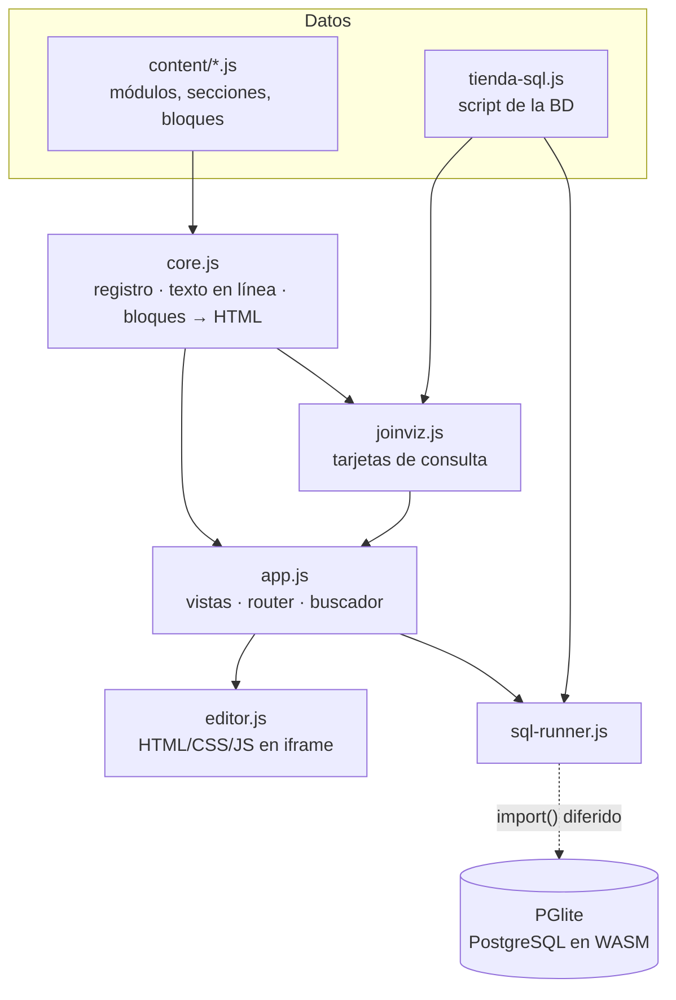

<div align="center">

# Nodex · Wiki técnica

**Cómo está construido _Apuntes 1.º DAW_ y por qué**

`Sitio estático` · `Sin framework ni compilación` · `PostgreSQL real en el navegador` · `GitHub Pages`

</div>

> Guía breve de la arquitectura. El diseño visual está en [`FOUNDATIONS-DESIGN.md`](FOUNDATIONS-DESIGN.md) y el arranque rápido en [`README.md`](README.md).

---

<a id="indice"></a>

## Índice

1. [Qué es](#p1)
2. [Estructura](#p2)
3. [Arquitectura](#p3)
4. [Modelo de contenido](#p4)
5. [Cómo funciona](#p5)
6. [CSS](#p6)
7. [Seguridad y rendimiento](#p7)
8. [Pipeline de autor y verificación](#p8)
9. [Despliegue](#p9)
10. [Decisiones: por qué así y no de otra forma](#p10)
11. [Limitaciones](#p11)
12. [Cómo ampliar](#p12)

---

<a id="p1"></a>

## 1. Qué es

Una guía de estudio de 1.º DAW con cinco temarios (HTML, CSS, JavaScript, Java y SQL), publicada como **web estática**. Los ejemplos de HTML/CSS/JS se editan y se ven al instante; el SQL se ejecuta contra **PostgreSQL real dentro del navegador**. No hay servidor, cuentas ni peticiones a terceros.

| Dato | Valor |
|---|--:|
| Módulos escritos | 91 (HTML 16 · CSS 19 · JS 18 · Java 14 · SQL 24) |
| Secciones / bloques | 461 / 1 377 |
| Editores en vivo | 258 |
| JS de la aplicación | ≈ 950 líneas en 5 ficheros |
| Motor SQL (PGlite) | ≈ 17 MB, **solo se descarga si se pulsa «Ejecutar»** |

<p align="right"><sub><a href="#indice">↑ Índice</a> · <a href="#p2">Siguiente →</a></sub></p>

---

<a id="p2"></a>

## 2. Estructura

```text
index.html          esqueleto + orden de carga de los scripts
css/                tokens.css (valores) · base · layout · components/ (22 ficheros, uno por componente)
js/                 core.js · app.js · editor.js · sql-runner.js · joinviz.js
content/            los temarios como datos (módulos → secciones → bloques) + tienda-sql.js (BD de práctica)
vendor/             Fira Code, highlight.js y PGlite copiados al repo (versión fija)
scripts/            herramientas de autor (no forman parte de la web)
docs/foundations/   SVG generados para FOUNDATIONS-DESIGN.md
```

La web solo usa lo que está en `index.html`, `css/`, `js/`, `content/`, `vendor/` y `favicon.svg`. Nada importa de `scripts/` ni de `docs/`.

<p align="right"><sub><a href="#indice">↑ Índice</a> · <a href="#p1">← Anterior</a> · <a href="#p3">Siguiente →</a></sub></p>

---

<a id="p3"></a>

## 3. Arquitectura

Todo ocurre en el navegador. Un único objeto global, `window.APP`, agrupa la aplicación.



| Capa | Responsabilidad |
|---|---|
| **Datos** (`content/`) | Qué se enseña. Solo datos, sin HTML ni lógica. |
| **Núcleo** (`core.js`) | Convierte un bloque de datos en una cadena HTML. |
| **Presentación** (`app.js`, `joinviz.js`) | Pinta cada vista una sola vez en `<main>`. |
| **Interacción** (`editor.js`, `sql-runner.js`) | Convierten marcadores `[data-live]` en editores *después* de pintar. |

**Orden de carga** (importa): `hljs → core → syllabus → ficheros de contenido → tienda-sql → joinviz → editor → sql-runner → app`. Los ficheros de contenido se *fusionan* con el `syllabus` mediante `APP.register`, así que un temario puede repartirse en varios ficheros (SQL: base, JOIN, cálculos y misiones). `app.js` va último porque es el único que actúa al cargarse: lee la URL y pinta.

<p align="right"><sub><a href="#indice">↑ Índice</a> · <a href="#p2">← Anterior</a> · <a href="#p4">Siguiente →</a></sub></p>

---

<a id="p4"></a>

## 4. Modelo de contenido

```js
APP.register({ slug: "sql", nombre: "SQL", modulos: [ { id: "mod-09", num: "09", title: "SELECT básico" } ] });
APP.register({ slug: "sql", contenido: { "mod-09": {
  resumen: "…",
  secciones: [ { id: "select-basico", titulo: "…", bloques: [ { p: "…" }, { code: "SELECT 1;", lang: "sql" } ] } ]
} } });
```

Un módulo sin `contenido` aparece como «en preparación». Los `id` de módulo y de sección son **anclas estables**: forman la URL y las usa el buscador.

**Tipos de bloque** (una clave identifica cada uno): `p`, `h4`, `code`, `consola`, `tabla`, `lista`, `nota`, `aviso`, `sub`, `img`, `details`, `live` (editor HTML/CSS/JS o SQL) y `join` (tarjeta de consulta).

**Texto en línea:** `` `código` ``, `**negrita**`, `{{Tecla}}`, `[[ok]]`, `[texto](@id-seccion)`, `[texto](https://…)` y `((tabla|texto))` (color de tabla). El texto se escapa **antes** de sustituir la sintaxis, así que nada de contenido llega al DOM sin escapar.

<p align="right"><sub><a href="#indice">↑ Índice</a> · <a href="#p3">← Anterior</a> · <a href="#p5">Siguiente →</a></sub></p>

---

<a id="p5"></a>

## 5. Cómo funciona

**Enrutado.** URLs con hash: `#/` (portada), `#/sql` (índice), `#/sql/mod-09` (módulo) y `#/sql/select-basico` (módulo + scroll a la sección). Un único `click` delegado intercepta los enlaces `#/…`. El hash se guarda también en una variable, por si la barra de direcciones no se actualiza (vistas incrustadas).

**Renderizado.** Cada vista es una plantilla de texto asignada a `main.innerHTML` una sola vez. Los bloques `live` dejan un marcador y `APP.mountLive` los sustituye por editores. El código se resalta con highlight.js y el CSS reasigna sus clases a los colores del tema de la marca.

**Buscador.** Un `<dialog>` (tecla `/`). El índice se construye al primer uso, con una entrada por sección y el texto normalizado (minúsculas y sin tildes). Deben aparecer todos los términos; el título pesa más que el cuerpo.

**Editor HTML/CSS/JS.** El ejemplo corre en un `iframe` con `sandbox="allow-scripts"` y **sin** `allow-same-origin`: origen opaco, no puede tocar la aplicación. La consola del ejemplo llega al padre por `postMessage`, validando el origen del mensaje. Con JS, solo se ejecuta al pulsar **Ejecutar**, para que un bucle a medio escribir no cuelgue la página.

**SQL.** `sql-runner.js` carga PGlite con `import()` la primera vez que se ejecuta algo y crea la base `tienda_online` desde `APP.tiendaSql`. Las operaciones pasan por una cola, y «Restablecer BD» recrea el esquema con los datos originales.

**Tarjetas JOIN (`joinviz.js`).** Cada consulta se explica con **un color por tabla**. El motor lee las filas reales *parseando los `INSERT` de la propia BD*, calcula el resultado (inner, left, right, full, cross, `WHERE`, agregados, orden y límite) y dibuja el diagrama en SVG. Las filas sin pareja se marcan con `✕`/`∅` y trama, no solo con color. Los resultados de las 42 consultas del contenido se contrastan con PostgreSQL real (`scripts/verify_join.py`) y coinciden.

<p align="right"><sub><a href="#indice">↑ Índice</a> · <a href="#p4">← Anterior</a> · <a href="#p6">Siguiente →</a></sub></p>

---

<a id="p6"></a>

## 6. CSS

- **`@layer tokens, base, layout, components, utilities`:** manda el orden de capas, no la especificidad.
- **Tokens** en `tokens.css`: ninguna medida ni color «suelto» en los componentes.
- **BEM en inglés**, un fichero por componente, sin anidar selectores.
- **CSS nativo**, sin Sass ni Tailwind. La tarjeta JOIN usa *container queries*.
- Tres puntos de quiebre: 1360, 960 y 640 px.

<p align="right"><sub><a href="#indice">↑ Índice</a> · <a href="#p5">← Anterior</a> · <a href="#p7">Siguiente →</a></sub></p>

---

<a id="p7"></a>

## 7. Seguridad y rendimiento

- **Sin estado ni red:** no hay `localStorage`, cookies, `fetch` ni analítica. Lo único que se carga dinámicamente es el motor SQL, desde el propio sitio.
- **Código del usuario aislado** en un `iframe` de origen opaco; el SQL corre en memoria de la pestaña y no sale del navegador.
- **Rápido por no hacer:** sin framework, una escritura de DOM por vista, motor SQL de carga diferida, fuentes propias (2 pesos) y cero peticiones a terceros.

<p align="right"><sub><a href="#indice">↑ Índice</a> · <a href="#p6">← Anterior</a> · <a href="#p8">Siguiente →</a></sub></p>

---

<a id="p8"></a>

## 8. Pipeline de autor y verificación

El contenido grande **no se escribe a mano**: se genera con scripts y se versiona el resultado.

| Script | Función |
|---|---|
| `convert.py`, `mark-sql.mjs` | Convierte los apuntes a bloques y marca como ejecutables los SQL que **funcionan de verdad** en PGlite. |
| `jslib.py`, `js_a…d.py`, `gen_js.py` | El temario de JS, escrito en Python y serializado a `content/js.js`. |
| `join_content.py`, `mision_content.py`, `calc_exprs.py`, `pgeval.py` | Módulos de JOIN, misiones y chuleta; los resultados se **obtienen ejecutando** cada expresión. |
| `verify_join.py` | Contrasta el motor de `joinviz` con PostgreSQL. |
| `bundle.py` | Empaqueta todo en `dist/index.html` para probar sin servidor (no se versiona). |
| `gen_foundations.py` | Genera los SVG de `FOUNDATIONS-DESIGN.md` desde `tokens.css`. |

Principio: **un resultado que sale en pantalla se obtiene ejecutándolo**, no escribiéndolo a mano.

<p align="right"><sub><a href="#indice">↑ Índice</a> · <a href="#p7">← Anterior</a> · <a href="#p9">Siguiente →</a></sub></p>

---

<a id="p9"></a>

## 9. Despliegue

GitHub Pages desde `main`, carpeta raíz, sin compilación (`.nojekyll` desactiva Jekyll). Un `git push` publica en uno o dos minutos; conviene recargar sin caché (`Ctrl`+`Shift`+`R`). En local hace falta un servidor (`python -m http.server 8000`), porque abrir `index.html` con doble clic impide cargar el motor SQL.

<p align="right"><sub><a href="#indice">↑ Índice</a> · <a href="#p8">← Anterior</a> · <a href="#p10">Siguiente →</a></sub></p>

---

<a id="p10"></a>

## 10. Decisiones: por qué así y no de otra forma

| Decisión | Alternativas descartadas y motivo |
|---|---|
| **Sitio estático, sin framework ni build** | React/Vue/Astro: aportan reactividad que no hace falta (cada vista se pinta una vez desde datos estáticos) y añaden compilación y dependencias para una sola persona. |
| **Scripts clásicos + `window.APP`** | Módulos ES o bundler: exigirían servidor siempre y complicarían el empaquetado en un fichero. Coste asumido: acoplamiento por orden de carga. |
| **Contenido como datos estructurados en JS** | Markdown en cliente: no expresa editores, tarjetas JOIN ni avisos tipados. HTML a mano: mezcla contenido y diseño. JSON + `fetch`: pide servidor. Con datos, un cambio de diseño se hace en una función y el buscador sale de la estructura. |
| **Rutas con hash** | History API: GitHub Pages no reescribe URLs, así que recargar `/sql/mod-09` daría 404. |
| **PostgreSQL real (PGlite)** | SQLite en WASM: pesa menos pero es **otro dialecto** y enseñaría sintaxis que en PostgreSQL no existe. Servidor propio: coste y riesgo, y Pages no lo permite. |
| **Librerías y fuentes en `vendor/`** | CDN: una caída o un bloqueo de red rompería la app y cada visita enviaría datos a un tercero. |
| **Diagrama JOIN calculado con datos reales** | Imágenes a mano: se quedan obsoletas y no son accesibles. Ejecutar PGlite para dibujar: obligaría a bajar 17 MB solo por *leer* la explicación. Riesgo del motor propio: divergir de SQL, mitigado con verificación automática. |
| **Resultados obtenidos ejecutando** | Escribirlos a mano es la fuente clásica de errores en material didáctico. |
| **CSS nativo con capas, tokens y BEM** | Tailwind/Sass/CSS-in-JS: compilación o dependencia sin beneficio aquí. |
| **Una sola familia monoespaciada, sin ligaduras** | Con ligaduras, `==` se dibujaría como `=`: enseñaría mal justo los operadores. |
| **Editor en `iframe` aislado** | `eval` en la página: un ejemplo podría romper la app o leer su estado. |
| **Buscador propio** | lunr/Fuse: para ≈ 460 secciones una búsqueda simple es instantánea y sin dependencias. Sin búsqueda difusa. |

<p align="right"><sub><a href="#indice">↑ Índice</a> · <a href="#p9">← Anterior</a> · <a href="#p11">Siguiente →</a></sub></p>

---

<a id="p11"></a>

## 11. Limitaciones

| Tema | Detalle |
|---|---|
| Peso del SQL | ≈ 17 MB la primera vez; sin *Service Worker* no hay uso sin conexión garantizado. |
| Navegadores | Requiere navegadores actuales (capas CSS, container queries, `<dialog>`). |
| Estado global | `window.APP` y el orden de `<script>` acoplan los ficheros; si el proyecto crece, migrar a módulos ES. |
| Motor JOIN | Reimplementa parte de SQL: una consulta nueva fuera de lo soportado hay que añadirla al motor y a la verificación. |
| Licencias | Falta copiar el texto de licencia de Fira Code y highlight.js a `vendor/`. |
| Pruebas | Verificaciones por script; no hay suite automática de interfaz. |
| Autoría | El contenido se elaboró con asistencia de IA y se comprobó ejecutándolo donde fue posible; conviene contrastarlo con el material del curso. |

<p align="right"><sub><a href="#indice">↑ Índice</a> · <a href="#p10">← Anterior</a> · <a href="#p12">Siguiente →</a></sub></p>

---

<a id="p12"></a>

## 12. Cómo ampliar

- **Módulo nuevo:** declararlo en `content/syllabus.js`, escribir su `contenido["mod-nn"]` (con un aviso «Ojo» del error típico) y comprobar que pinta, se indexa en el buscador y enlaza con sus vecinos.
- **Tipo de bloque nuevo:** rama en `APP.block` y en `APP.plain` (`core.js`) + un fichero en `css/components/` usando solo tokens.
- **Cambio de diseño:** editar `css/tokens.css`, ejecutar `python scripts/gen_foundations.py` y actualizar `FOUNDATIONS-DESIGN.md`.

<p align="right"><sub><a href="#indice">↑ Índice</a> · <a href="#p11">← Anterior</a></sub></p>
